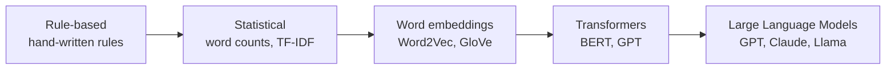
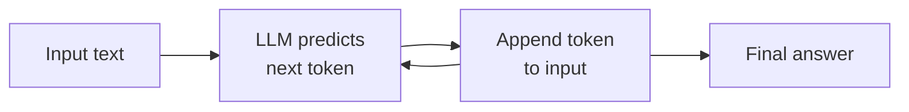
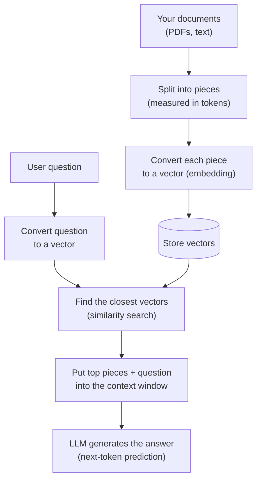

# 00 - Prerequisites: What You Need Before Learning RAG

> Before building a RAG system, I needed a few basic ideas to be clear in my head: **NLP, vectors, LLMs, tokens, and the context window**. Almost every RAG decision (chunk size, embedding model, how many documents to retrieve) comes back to one of these five things. This chapter is my attempt to explain them the way I wish someone had explained them to me.

**What you'll understand after this chapter**

- How a computer "reads" text
- What a vector is and why it can capture meaning
- What an LLM actually does (and what it cannot do)
- What tokens are and why they cost money
- What the context window is and why it creates the need for RAG

---

## 1. NLP (Natural Language Processing)

### What it is

NLP is the field of teaching computers to work with human language. Computers only understand numbers. Humans write sentences like *"The bank was crowded."* NLP is the bridge between the two.

### Why it's hard

Language is messy:

| Problem | Example |
|---|---|
| **Ambiguity** | "I went to the **bank**" - river bank or money bank? |
| **Synonyms** | "car", "automobile", "vehicle" all mean almost the same thing |
| **Context** | "It's cold" means different things in a weather report and a restaurant review |
| **Word order** | "Dog bites man" vs "Man bites dog" |

A simple keyword search fails on all of these. Searching for "automobile" will not find a document that only says "car". This is the exact reason RAG needs something smarter than keyword matching.

### How NLP evolved (short version)



- **Bag of words / TF-IDF**: count the words. Fast, but has no idea of meaning.
- **Word embeddings**: each word gets a list of numbers, so similar words land close together.
- **Transformers (2017)**: models that look at the whole sentence at once and understand context. This is the foundation of everything we use today.

### Why it matters for RAG

RAG depends on two NLP abilities:

1. **Understanding meaning** when searching (embeddings)
2. **Generating language** when answering (LLMs)

---

## 2. Vectors

This is the most important idea in the entire guide, so I'll go slowly.

### What is a vector?

A vector is just a **list of numbers**.

```
[0.2, 0.8, 0.1]
```

You can think of it as coordinates. In 2D, `(3, 4)` is a point on a graph. In 3D, `(3, 4, 5)` is a point in space. A vector with 384 or 1536 numbers is the same idea, just in a space we can't picture.

### How can numbers represent meaning?

Imagine we describe animals with just two features: *how big* and *how dangerous*.

| Animal | Size | Danger |
|---|---|---|
| Cat | 0.2 | 0.1 |
| Lion | 0.8 | 0.9 |
| Tiger | 0.8 | 0.9 |
| Mouse | 0.05 | 0.05 |

Lion and tiger have almost the same numbers, so they sit close together. Cat and mouse are close to each other. This is the whole idea: **similar things get similar numbers, so they sit near each other**.

A real embedding model does this with hundreds of features, and it learns those features by itself from huge amounts of text. We don't know what each number "means", but the overall position captures meaning.

### Embeddings

An **embedding** is a vector that represents a piece of text (a word, sentence, or paragraph) such that **texts with similar meaning have similar vectors**.

```
"How do I reset my password?"      -> [0.12, -0.45, 0.88, ...]
"I forgot my login credentials"    -> [0.10, -0.41, 0.90, ...]   <- very close!
"What's the weather in Paris?"     -> [-0.70, 0.22, 0.05, ...]   <- far away
```

The first two sentences share almost no words, yet their vectors are close. That is how semantic search works and why it beats keyword search.

### Measuring "closeness": similarity

To find similar text, we measure how close two vectors are. The most common ways:

| Metric | Idea | When used |
|---|---|---|
| **Cosine similarity** | Angle between vectors. Ignores length. Range -1 to 1. | Most common for text |
| **Dot product** | Angle and length combined | Fast, common with normalized vectors |
| **Euclidean (L2) distance** | Straight-line distance | Some vector DBs default to this |

**Cosine similarity in code:**

```python
import numpy as np

def cosine_similarity(a, b):
    a, b = np.array(a), np.array(b)
    return np.dot(a, b) / (np.linalg.norm(a) * np.linalg.norm(b))

lion  = [0.8, 0.9]
tiger = [0.8, 0.9]
mouse = [0.05, 0.05]
cat   = [0.2, 0.1]

print(cosine_similarity(lion, tiger))  # 1.0 -> identical direction
print(cosine_similarity(lion, cat))    # lower -> less similar
```

> **My takeaway:** cosine similarity cares about *direction*, not size. Two texts about the same topic point the same way even if one is much longer.

### Real embeddings in 5 lines

```python
from sentence_transformers import SentenceTransformer

model = SentenceTransformer("all-MiniLM-L6-v2")

sentences = [
    "How do I reset my password?",
    "I forgot my login credentials",
    "What's the weather in Paris?",
]
vectors = model.encode(sentences, normalize_embeddings=True)

print(vectors.shape)                 # (3, 384) -> 3 sentences, 384 numbers each
print(vectors[0] @ vectors[1])       # high score (similar meaning)
print(vectors[0] @ vectors[2])       # low score (unrelated)
```

Run this yourself and you will see the first pair score noticeably higher than the second. That small experiment is basically the heart of RAG retrieval.

---

## 3. LLMs (Large Language Models)

### What is an LLM?

An LLM is a neural network trained on a huge amount of text to do one deceptively simple job: **predict the next token**.

Given:

```
"The capital of France is"
```

It predicts the most likely next piece of text: `" Paris"`. Then it repeats the process, using its own output as the new input, one token at a time, until the answer is complete.

That's all. Everything an LLM does (writing code, summarizing, answering questions) comes from this loop done at massive scale.



### What LLMs are good at

- Understanding and writing natural language
- Summarizing, translating, explaining
- Following instructions
- Reasoning over text that is *in front of them*

### What LLMs are bad at (and why RAG exists)

This part matters most. LLMs have real limitations:

| Limitation | What it means | Example |
|---|---|---|
| **Knowledge cutoff** | They only know what was in their training data, up to a certain date | Can't know yesterday's news |
| **No private knowledge** | Never saw your company docs, PDFs, or emails | Can't answer "What's in our refund policy?" |
| **Hallucination** | When unsure, they may produce a confident but false answer | Invents a citation that doesn't exist |
| **No source tracking** | Can't tell you *where* a fact came from | "I read it somewhere" |
| **Fixed knowledge** | Updating facts means retraining or fine-tuning, which is expensive | Policy changed last week |

> **Why do they hallucinate?** Because the model's job is to produce *plausible-sounding* text, not *verified* text. If it doesn't know, it still produces the most likely-looking continuation. Nothing in the next-token loop says "stop and admit you don't know" unless we train or prompt it that way.

### The idea behind RAG

Think of an exam:

- **Plain LLM** = closed-book exam. The student answers from memory and may guess wrong.
- **RAG** = open-book exam. The student looks up the right pages first, then answers using them.

Same student, much more reliable answers. RAG simply hands the LLM the right information at question time.

### Useful LLM settings to know

| Setting | What it does |
|---|---|
| **Temperature** | Randomness. Low (0 to 0.3) = focused and consistent. High (0.8+) = creative. For RAG, use **low**, since we want faithful answers. |
| **Max tokens** | Upper limit on the length of the answer |
| **System prompt** | Instructions that set the model's behavior (e.g., "Answer only from the given context") |

---

## 4. Tokens

### What is a token?

LLMs don't read letters or whole words. They read **tokens**, which are chunks of text, usually pieces of words.

```
"Unbelievable chatbots"
 -> ["Un", "believ", "able", " chat", "bots"]    (illustrative split)
```

- Common words are often **one token**: `" the"`, `" hello"`
- Rare or long words get **split** into pieces
- Spaces, punctuation, and numbers also count

### Rule of thumb (English)

- **1 token is about 4 characters**
- **1 token is about 0.75 words**
- 100 tokens is about 75 words
- A typical page of text is about 500 to 700 tokens

Other languages (Hindi, Chinese, Arabic, etc.) usually need **more tokens** for the same meaning, so the same content costs more and fills the context faster.

### Count tokens yourself

```python
import tiktoken

enc = tiktoken.get_encoding("cl100k_base")

text = "Retrieval-Augmented Generation makes LLMs more reliable."
tokens = enc.encode(text)

print(len(tokens))                       # number of tokens
print([enc.decode([t]) for t in tokens]) # see how the text was split
```

Different models use different tokenizers, so counts vary a little. Treat `tiktoken` as a good estimate rather than an exact number for non-OpenAI models.

### Why tokens matter for RAG

1. **Cost**: APIs charge per token, for both input and output. Stuffing 20 chunks into every prompt gets expensive fast.
2. **Speed**: more input tokens means slower responses.
3. **Limits**: the context window (next section) is measured in tokens.
4. **Chunking**: when we split documents later, we think in tokens, not characters.

---

## 5. The Context Window

### What is it?

The **context window** is the maximum number of tokens an LLM can handle **at once**, covering everything: system prompt, retrieved documents, chat history, the user's question, **and** the answer it writes.

```
┌──────────────────────── Context Window ─────────────────────────┐
│ System prompt │ Chat history │ Retrieved chunks │ Question │ Answer │
└──────────────────────────────────────────────────────────────────┘
        All of this must fit in the same token budget
```

Think of it as the model's **working memory** or a desk. Only what's on the desk can be used. Anything that doesn't fit is invisible to the model.

### "Why not just paste the whole PDF into the prompt?"

Modern models have big windows (some reach hundreds of thousands, even millions of tokens), so this is a fair question. Here is why RAG is still useful:

| Problem with stuffing everything | Why it hurts |
|---|---|
| **Cost** | You pay for every token on every question |
| **Latency** | Longer prompts mean slower answers |
| **Still not enough** | A company knowledge base can be millions of pages |
| **Accuracy drops** | Models often miss details buried in very long inputs. Research calls this the **"lost in the middle"** problem: information in the middle of a long context is used less reliably than information at the start or end. |
| **Noise** | Irrelevant text distracts the model |
| **No control** | Hard to cite, filter, or update specific facts |

RAG's answer: **don't give the model everything, give it only the few most relevant pieces.**

### A quick budget example

Say a model has an 8,000 token window:

```
System prompt:           300
Chat history:            700
User question:           100
Reserved for the answer: 1,000
-----------------------------
Left for retrieved text: 5,900  ->  about 5 chunks of 1,000 tokens
```

This is the kind of calculation you will do when deciding **chunk size** and **top-k** in later chapters.

---

## 6. Putting It All Together

Here is how the five concepts connect to form RAG:



In one sentence:

> **RAG = use vectors to *find* the right text, then use an LLM to *write* the answer from that text, all within the limits of the context window.**

| Concept | Role in RAG |
|---|---|
| **NLP** | The field that makes text understandable to machines |
| **Vectors / Embeddings** | Turn text into numbers so we can *search by meaning* |
| **LLM** | Reads the retrieved text and *writes the answer* |
| **Tokens** | The unit that controls *cost, speed, and size* |
| **Context window** | The *limit* that forces us to retrieve only what matters |

---

## 7. Common Misunderstandings

- **"Embeddings and LLMs are the same thing."** They are not. Embedding models turn text into vectors for *searching*. LLMs *generate* text. RAG uses both, and they are usually different models.
- **"A bigger context window makes RAG obsolete."** Not really. Cost, latency, accuracy, and scale still matter.
- **"RAG removes hallucinations completely."** It reduces them a lot, but a bad retrieval or a weak prompt can still lead to wrong answers.
- **"One word = one token."** Not true. Count tokens, don't guess.
- **"Similar vectors mean the answer is correct."** Similar means *related*, not necessarily *right*. This is why reranking and evaluation matter later.

---

## 8. Key Takeaways

1. Computers need text as numbers. **Embeddings** turn meaning into vectors, and similar meaning means nearby vectors.
2. An **LLM** predicts the next token. It is powerful but has a knowledge cutoff, no access to private data, and can hallucinate.
3. **Tokens** are the unit of cost, speed, and limits.
4. The **context window** is the model's limited working memory, so we must choose carefully what goes in.
5. **RAG = retrieve the relevant text with vectors, then let the LLM answer from it.** It is an open-book exam for the model.

---

