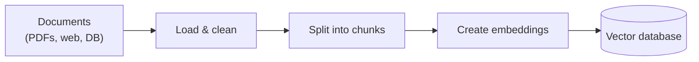
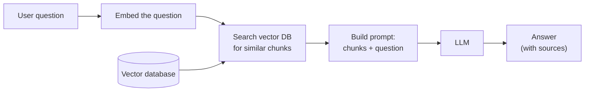
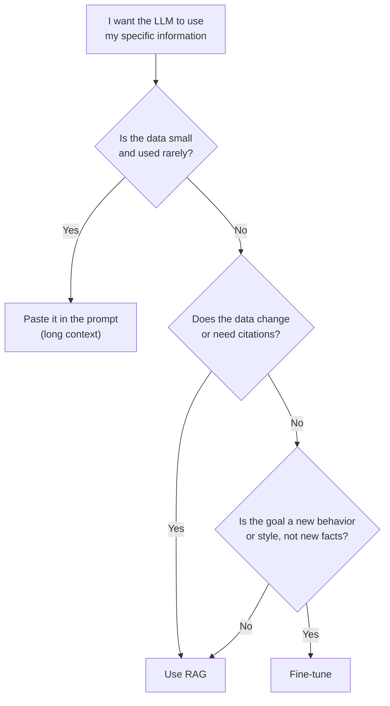

# 01 - Introduction to RAG: What It Is and Why It Exists

> When I first heard "Retrieval-Augmented Generation", it sounded like a very heavy term. After building a chatbot that answers questions from PDFs, I realized the idea is actually simple: **before the AI answers, let it look up the right information first.** This chapter explains what RAG is, why we need it, and how it compares with the other ways of teaching an LLM new things.

**What you'll understand after this chapter**

- What RAG is, in plain words
- The exact problems it solves
- How the full flow works at a high level
- RAG vs fine-tuning vs long context vs plain prompting (and when to pick which)
- Honest pros and cons
- A tiny working RAG example, so the idea feels real

*(Need a refresher on vectors, tokens, or the context window? Read [00 - Prerequisites](./00-prerequisites.md) first.)*

---

## 1. The Problem: LLMs Don't Know Everything

Imagine you ask an LLM:

> "What is the leave policy in my company's HR handbook?"

The model has never seen that handbook. It was trained on public internet text up to some date. It has three options:

1. Say "I don't know" (good, but not helpful)
2. Give a generic answer about leave policies (misleading)
3. **Make something up that sounds right** (dangerous)

Option 3 is called **hallucination**, and it happens a lot, because the model is built to produce fluent text, not to verify facts.

So the real problem has four parts:

| Problem | Why it happens |
|---|---|
| **Outdated knowledge** | Training stops at a cutoff date |
| **No private data** | Your PDFs, emails, and databases were never in training |
| **Hallucinations** | The model fills gaps with plausible guesses |
| **No sources** | It can't tell you *where* an answer came from |

---

## 2. What Is RAG?

**RAG (Retrieval-Augmented Generation)** is a technique where we:

1. **Retrieve** relevant information from our own data when a question arrives
2. **Augment** the prompt by adding that information next to the question
3. **Generate** the answer with the LLM, using that information

The name maps directly to the steps:

```
Retrieval  ->  Augmented  ->  Generation
 (find)        (add to prompt)    (answer)
```

### The open-book exam analogy

- **Plain LLM** is a student taking a *closed-book* exam. They answer from memory, and sometimes guess confidently.
- **RAG** is the same student in an *open-book* exam. They first flip to the right pages, then write the answer using those pages.

The student didn't become smarter. They just got access to the right information at the right moment. That is all RAG does.

### A tiny example

Without RAG:

```
User:  What's the refund window for premium plans?
LLM:   Typically 30 days...   <- a guess
```

With RAG:

```
Retrieved text: "Premium plan purchases can be refunded within 14 days of payment."

Prompt to LLM:
  Use only the context below to answer.
  Context: Premium plan purchases can be refunded within 14 days of payment.
  Question: What's the refund window for premium plans?

LLM:   Premium plans can be refunded within 14 days of payment.   <- grounded
```

Same model, but the second answer is correct because the right text was placed in front of it.

### A little history

RAG was introduced in the 2020 paper *"Retrieval-Augmented Generation for Knowledge-Intensive NLP Tasks"* by Lewis et al. (Facebook AI Research). In the original paper, the retriever and generator were trained together. Today, when people say "RAG", they usually mean a simpler, more practical setup: an off-the-shelf embedding model, a vector database, and a general-purpose LLM, connected by code. That is the version this guide builds.

---

## 3. How RAG Works (High-Level Flow)

RAG has **two phases**. I found it helpful to keep them separate in my head.

### Phase 1: Indexing (done once, in advance)

Preparing the "library" the model will search.



### Phase 2: Querying (done on every question)



### The same flow in words

1. **Load** documents (PDFs, web pages, etc.)
2. **Chunk** them into small pieces, because we can't search or fit whole books
3. **Embed** each chunk into a vector
4. **Store** the vectors in a vector database
5. When a question comes: **embed** it, **find the closest chunks**, **put them in the prompt**, and let the **LLM answer**

Each of these steps gets its own chapter later in this guide. For now, just see the shape of it.

---

## 4. A Minimal RAG in About 30 Lines

Seeing it work in a small form made it click for me. This tiny version has no framework and no database, only the core idea.

```python
from sentence_transformers import SentenceTransformer
import numpy as np

# 1. Our "knowledge base" (normally this comes from PDFs)
documents = [
    "Premium plan purchases can be refunded within 14 days of payment.",
    "Employees get 24 days of paid leave per year.",
    "Support is available Monday to Friday, 9 AM to 6 PM IST.",
    "Passwords must be at least 12 characters long.",
]

# 2. Embed all documents
model = SentenceTransformer("all-MiniLM-L6-v2")
doc_vectors = model.encode(documents, normalize_embeddings=True)

# 3. Retrieve: find the most similar document(s) for a question
def retrieve(question, k=2):
    q_vec = model.encode([question], normalize_embeddings=True)[0]
    scores = doc_vectors @ q_vec               # cosine similarity (vectors are normalized)
    top_ids = np.argsort(scores)[::-1][:k]
    return [documents[i] for i in top_ids]

# 4. Augment: build the prompt
def build_prompt(question):
    context = "\n".join(retrieve(question))
    return f"""Answer using ONLY the context below.
If the answer is not in the context, say "I don't know."

Context:
{context}

Question: {question}
Answer:"""

# 5. Generate: send the prompt to any LLM
question = "How many days do I have to ask for a refund?"
prompt = build_prompt(question)
print(prompt)
# answer = your_llm(prompt)    # OpenAI, Gemini, Claude, a local model, etc.
```

Run it and look at the printed prompt. The refund sentence will be ranked first, even though the question says "ask for a refund" and the document says "can be refunded". That is **semantic search** doing its job, and everything else in this guide is about making each of those five steps better, faster, and more reliable.

---

## 5. RAG vs Fine-Tuning vs Long Context vs Prompting

This is the question I get asked the most: *"Why not just fine-tune the model on my data?"* or *"Why not paste everything into the prompt?"* There are four common approaches, and they solve different problems.

### The four approaches

**1. Prompt engineering**
Write better instructions and maybe a few examples. No extra data, no extra infrastructure. Good for style, format, and simple tasks.

**2. Long context (stuff everything in the prompt)**
Paste the whole document into the model's context window. Simple, and works when the data is small.

**3. Fine-tuning**
Continue training the model on your own examples so its *weights* change. It is best for changing *behavior*, such as tone, format, or a specialized skill. It is not a reliable way to teach it a large set of facts.

**4. RAG**
Keep your knowledge *outside* the model and fetch what's needed at question time.

### Comparison table

| | Prompting | Long context | Fine-tuning | RAG |
|---|---|---|---|---|
| **Best for** | Style, format, simple tasks | Small docs, one-off questions | Teaching behavior, tone, specialized skills | Answering from large or changing knowledge |
| **Handles large data?** | No | Limited by window | Not efficiently for facts | Yes |
| **Fresh data?** | Manual | Re-paste each time | Needs retraining | Just update the index |
| **Private data?** | In the prompt only | In the prompt only | Baked into weights (hard to remove) | Stays in your database |
| **Can cite sources?** | No | Partly | No | Yes (chunks have metadata) |
| **Hallucination control** | Weak | Medium | Weak for facts | Good (grounded in text) |
| **Setup effort** | Very low | Low | High (data, GPU, evaluation) | Medium |
| **Running cost** | Low | High per query on big inputs | Training cost, then normal | Small retrieval cost per query |
| **Access control** | None | Hard | Very hard | Easy (filter by user or metadata) |

### The key insight I took from this

> **Fine-tuning changes *how the model behaves*. RAG changes *what the model knows right now*.**

- Want the model to **write in your brand voice** or output a strict JSON format? Fine-tuning or prompting.
- Want it to **answer questions about your documents**, which change often? RAG.
- Want both? Combine them. A fine-tuned model with RAG is common in serious systems.

### Why not just use long context?

Long context windows keep getting bigger, so it is tempting to skip RAG. In practice:

- You pay for **every token on every question**
- Long prompts are **slower**
- Models can miss details buried in the middle of very long inputs
- A real knowledge base (thousands of files) **still won't fit**
- You can't easily say "only show this user the documents they're allowed to see"

Long context is great for a single document or a quick analysis. RAG is better for large, shared, or frequently updated knowledge. They are also not enemies: a good RAG system can use a larger context window to include more retrieved chunks.

### Quick decision guide



---

## 6. Where RAG Is Used

- **Chat with your documents** (PDFs, reports, manuals), the project this guide grew from
- **Customer support bots** answering from help articles and past tickets
- **Internal company assistants** over HR, IT, and policy documents
- **Legal and compliance search**, finding clauses and precedents
- **Healthcare and research assistants** that cite papers
- **Code assistants** that search a codebase
- **E-commerce Q&A** using product catalogs

---

## 7. Pros and Cons (Honest Version)

### Advantages

- **Fewer hallucinations**, because answers are grounded in real text
- **Up-to-date**: update the index, not the model
- **Private data stays under your control**
- **Citations**: you can show the source page
- **Cheaper than retraining** for knowledge updates
- **Works with any LLM**, so you can swap models freely
- **Access control** is possible: retrieve only what a user may see

### Limitations

- **Quality depends on retrieval.** If the right chunk isn't found, even the best LLM can't answer. In my experience, most RAG problems are retrieval problems.
- **Messy data gives messy results.** Bad PDF parsing means bad answers.
- **More moving parts**: chunking, embeddings, database, reranking, prompts, and each needs tuning.
- **Added latency**: retrieval takes time before generation starts.
- **Struggles with some questions**, such as "summarize the entire document" or questions that need reasoning across many scattered chunks.
- **Hard to evaluate**: you must measure retrieval *and* generation, and many people skip this.
- **Still not 100% hallucination-proof**: the model can ignore or misread the context.

> RAG is not magic. It is a way to give the LLM better information, and the quality of the answer depends on the quality of what you retrieve.

---

## 8. Common Misunderstandings

- **"RAG means training the model on my data."** No. The model's weights never change. Your data stays outside and is fetched at question time.
- **"RAG is just a vector database."** The vector database is one part. Chunking, embeddings, retrieval strategy, prompting, and evaluation matter just as much.
- **"RAG and fine-tuning are competitors."** They solve different problems and can be combined.
- **"Once built, RAG works well forever."** Documents change, questions change, and you need to monitor and re-evaluate.
- **"More retrieved chunks always means better answers."** Extra chunks add noise, cost, and confusion.

---

## 9. Key Takeaways

1. LLMs have **outdated knowledge, no access to private data, and a habit of hallucinating**.
2. **RAG = Retrieve relevant text, Augment the prompt with it, Generate the answer.** It is an open-book exam for the model.
3. It runs in two phases: **indexing** (prepare the data once) and **querying** (retrieve and answer for each question).
4. **Fine-tuning changes behavior, RAG changes knowledge.** Long context is fine for small inputs but doesn't scale.
5. RAG's biggest strength is **grounded, citeable, updatable answers**, and its biggest weakness is that **bad retrieval means bad answers**.

---

## 10. Quick Self-Check

1. In your own words, what do the three letters R, A, and G stand for in practice?
2. Why can't a plain LLM answer questions about your company's private PDFs?
3. When would you choose fine-tuning over RAG? When would you choose RAG over fine-tuning?
4. Give two reasons why pasting a 500-page document into every prompt is a bad idea.
5. What is the difference between the indexing phase and the querying phase?

---

## 11. Hands-On Practice

1. Run the 30-line example above with your own 5 to 10 sentences. Try questions that **reuse no words** from the documents and see if retrieval still works.
2. Ask a question whose answer is **not** in your documents. Print the retrieved text. What does the retriever return anyway, and what does that tell you about needing a score threshold or an "I don't know" rule?
3. Write down one real problem from your life or work and decide: prompting, long context, fine-tuning, or RAG? Justify it in 3 lines.

---

