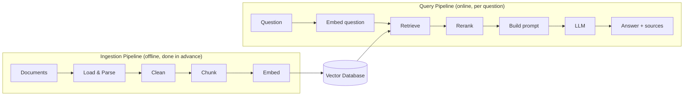

# 02 - RAG Architecture: Ingestion Pipeline vs Query Pipeline

> In the last chapter I explained what RAG is. In this one I want to show how a RAG system is actually put together. The best thing I learned here is that RAG is really **two separate pipelines** that meet at one place: the vector database. Once I understood this, every other chapter became easier to place in the big picture.

**What you'll understand after this chapter**

- The two pipelines of RAG and why they are kept separate
- What happens in each step of both pipelines
- How data moves through the system
- Where things usually go wrong
- How this maps to real project files

---

## 1. The Big Picture

Think of a library.

- **Before anyone visits**, the librarian collects books, sorts them into sections, and writes an index card for each one. This is slow work, but it is done in advance.
- **When a visitor asks a question**, the librarian uses the index to quickly find the right books, reads the right pages, and gives an answer.

RAG works exactly like this:

| Library | RAG |
|---|---|
| Preparing and indexing the books | **Ingestion pipeline** (offline) |
| Answering a visitor's question | **Query pipeline** (online) |
| The index / shelves | **Vector database** |



The vector database is the meeting point. The ingestion pipeline **writes** to it. The query pipeline **reads** from it.

---

## 2. Why Two Pipelines?

I used to wonder why we don't just do everything when the question arrives. There are good reasons to separate them:

| | Ingestion Pipeline | Query Pipeline |
|---|---|---|
| **When it runs** | Once, or whenever documents change | Every time a user asks something |
| **Speed matters?** | Not much, it can take minutes or hours | Very much, users are waiting |
| **Work done** | Heavy: read files, split, embed everything | Light: embed one question, search, generate |
| **Runs on** | Background job or script | Live API or app |
| **Failure impact** | Index is stale or incomplete | User gets a bad or slow answer |

If we embedded all the documents on every question, the chatbot would take forever and cost a lot. So we do the heavy work once and keep the results ready.

---

## 3. The Ingestion Pipeline (Step by Step)

This is how raw files become searchable knowledge.

### Step 1: Load

Read the files from wherever they live: PDFs, Word files, web pages, databases, Notion, Google Drive.

```python
from pypdf import PdfReader

def load_pdf(path):
    reader = PdfReader(path)
    return [
        {"text": page.extract_text() or "", "page": i + 1, "source": path}
        for i, page in enumerate(reader.pages)
    ]
```

Notice we keep `page` and `source` next to the text. This is called **metadata**, and we will need it later to show citations.

### Step 2: Clean

Raw text from PDFs is messy. It can contain headers and footers on every page, broken lines, extra spaces, or strange characters. Cleaning removes this noise.

```python
import re

def clean_text(text):
    text = re.sub(r"\s+", " ", text)   # collapse extra spaces and newlines
    return text.strip()
```

Bad input gives bad results, and no model can fix a badly parsed document.

### Step 3: Chunk

Split the text into smaller pieces. We do this because we can't fit whole documents into the prompt, and a small focused piece is easier to match with a question.

```python
def chunk_text(text, chunk_size=500, overlap=100):
    chunks, start = [], 0
    while start < len(text):
        chunks.append(text[start:start + chunk_size])
        start += chunk_size - overlap
    return chunks
```

The `overlap` keeps a little of the previous chunk so a sentence isn't cut in half and lost.

### Step 4: Embed

Turn each chunk into a vector using an embedding model.

```python
from sentence_transformers import SentenceTransformer

embed_model = SentenceTransformer("all-MiniLM-L6-v2")
vectors = embed_model.encode(chunk_texts, normalize_embeddings=True)
```

### Step 5: Store

Save the vectors, the chunk text, and the metadata in the vector database.

```python
import faiss
import numpy as np

index = faiss.IndexFlatIP(vectors.shape[1])
index.add(np.array(vectors, dtype="float32"))
# keep chunk text + metadata in a list or database, same order as the vectors
```

A vector database stores three things for each chunk:

```
[ vector ]  +  [ original text ]  +  [ metadata: source, page, date, ... ]
```

The vector is used for searching. The text and metadata are what we show to the LLM and the user.

---

## 4. The Query Pipeline (Step by Step)

This runs every time a user asks a question.

### Step 1: Embed the question

Use the **same embedding model** that was used during ingestion.

```python
q_vec = embed_model.encode([question], normalize_embeddings=True).astype("float32")
```

> This is a rule I won't forget: if you use one model to embed the documents and a different one to embed the question, the vectors live in different "spaces" and the search results will be nonsense.

### Step 2: Retrieve

Find the chunks whose vectors are closest to the question's vector.

```python
scores, ids = index.search(q_vec, 10)
candidates = [chunks[i] for i in ids[0]]
```

### Step 3: Rerank (optional but useful)

The first search is fast but rough. A reranker re-reads the top results together with the question and puts the best ones first.

```python
from sentence_transformers import CrossEncoder

reranker = CrossEncoder("cross-encoder/ms-marco-MiniLM-L-6-v2")
pairs = [(question, c["text"]) for c in candidates]
scores = reranker.predict(pairs)
ranked = [c for _, c in sorted(zip(scores, candidates), key=lambda x: x[0], reverse=True)]
top_chunks = ranked[:3]
```

The pattern is: **retrieve many cheaply, then keep a few carefully.**

### Step 4: Build the prompt

Put the question and the chosen chunks together with clear instructions.

```python
def build_prompt(question, chunks):
    context = "\n\n".join(f"[Page {c['page']}] {c['text']}" for c in chunks)
    return f"""Answer using ONLY the context below.
If the answer is not in the context, say "I don't know."
Mention the page numbers you used.

Context:
{context}

Question: {question}
Answer:"""
```

### Step 5: Generate

Send the prompt to the LLM.

```python
answer = llm(build_prompt(question, top_chunks))   # any LLM API or local model
```

### Step 6: Return answer with sources

Show the answer along with the pages or files it came from, so the user can verify it.

---

## 5. Putting Both Pipelines in Two Functions

A clean RAG project can be summed up as two functions:

```python
def ingest(pdf_paths):
    """Run once (or when documents change)."""
    all_chunks = []
    for path in pdf_paths:
        for page in load_pdf(path):
            text = clean_text(page["text"])
            for piece in chunk_text(text):
                all_chunks.append({"text": piece, "page": page["page"], "source": page["source"]})

    vectors = embed_model.encode([c["text"] for c in all_chunks], normalize_embeddings=True)
    index = faiss.IndexFlatIP(vectors.shape[1])
    index.add(np.array(vectors, dtype="float32"))
    return index, all_chunks


def ask(question, index, chunks, k=10, top_n=3):
    """Run for every question."""
    q_vec = embed_model.encode([question], normalize_embeddings=True).astype("float32")
    _, ids = index.search(q_vec, k)
    candidates = [chunks[i] for i in ids[0]]
    top_chunks = rerank(question, candidates)[:top_n]
    answer = llm(build_prompt(question, top_chunks))
    return answer, top_chunks      # return the chunks too, for citations
```

That is the whole system in simple form. Everything else in this guide is about making each line of these two functions better.

---

## 6. The Components and Their Choices

Every box in the diagram is a decision. Here are the main ones, with the chapter where each is covered.

| Component | What it does | Common options | Chapter |
|---|---|---|---|
| **Loader / Parser** | Reads files into text | PyPDF, PyMuPDF, Unstructured, OCR | 03 |
| **Chunker** | Splits text | Fixed, recursive, semantic | 04 |
| **Embedding model** | Text to vector | MiniLM, BGE, E5, OpenAI embeddings | 05 |
| **Vector database** | Stores and searches vectors | FAISS, Chroma, Qdrant, pgvector | 06 |
| **Retriever** | Finds candidates | Dense, BM25, hybrid | 07 |
| **Query transformer** | Improves the question | Rewriting, multi-query, HyDE | 08 |
| **Reranker** | Reorders candidates | Cross-encoder, Cohere Rerank | 09 |
| **Prompt + LLM** | Writes the answer | Any LLM | 10 |
| **Memory** | Handles follow-up questions | Chat history, query rewriting | 11 |
| **Evaluation** | Measures quality | Recall@k, RAGAS | 13 |

---

## 7. Where Time Goes in the Query Pipeline

When a user waits for an answer, the time is spent roughly like this:

```
Embed question   ->  very fast (milliseconds)
Vector search    ->  fast       (milliseconds to tens of milliseconds)
Reranking        ->  moderate   (adds noticeable time)
LLM generation   ->  slowest    (often most of the total time)
```

The exact numbers depend on your hardware and models, so measure your own system instead of trusting a table. The useful point is that **the LLM call usually dominates**, so cutting the number of tokens you send (fewer, better chunks) helps both speed and cost.

---

## 8. Keeping the Index Up to Date

Documents change, and the ingestion pipeline needs a plan for that:

- **Add new documents**: just embed and add them
- **Update a document**: delete its old chunks, then re-ingest it
- **Delete a document**: remove all chunks that have its `source`
- **Avoid duplicates**: store a hash of each file or chunk and skip ones you've already seen
- **Changing the embedding model**: you must re-embed **everything**, because old and new vectors can't be compared

This is why metadata like `source` and a document ID is not optional. Without it, you can't update or delete anything cleanly.

---

## 9. Where Things Usually Go Wrong

I found it useful to think of failures by stage:

| Stage | Typical problem | Symptom |
|---|---|---|
| Load | Scanned PDF has no text, tables get scrambled | Empty or garbled chunks |
| Clean | Headers and footers repeated in every chunk | Retrieval matches useless text |
| Chunk | Chunks too big or too small | Missing context or noisy results |
| Embed | Wrong or mismatched model | Irrelevant results |
| Store | No metadata saved | No citations, can't update |
| Retrieve | Right chunk exists but isn't in the top results | "I don't know" for answerable questions |
| Rerank | Skipped, or wrong model | Correct chunk ranked too low |
| Prompt | Vague instructions | Model ignores context or guesses |
| Generate | Too many chunks, high temperature | Rambling or invented details |

A habit I want to build: when an answer is wrong, first ask **"Was the right chunk retrieved?"** If not, it's a retrieval problem. If yes, and the answer is still wrong, it's a prompt or generation problem. This simple question saves hours of debugging.

---

## 10. Naive RAG vs Advanced RAG

You will hear these terms, so here they are in simple words.

- **Naive RAG**: the basic flow in this chapter. Chunk, embed, retrieve top-k, generate.
- **Advanced RAG**: the same flow with improvements added at different points:
  - **Before retrieval**: better parsing and chunking, query rewriting
  - **During retrieval**: hybrid search, metadata filters
  - **After retrieval**: reranking, compressing context

Start with naive RAG, measure it, and only add complexity where the measurements show a problem. This guide follows that order.

---

## 11. How This Maps to the Project Files

If you follow the structure suggested for this repo, each part of the architecture has a home:

```
src/
├── ingest.py          -> Step 1 & 2 of ingestion (load, clean)
├── chunking.py        -> Step 3 (chunk)
├── embeddings.py      -> Step 4 (embed)
├── vector_store.py    -> Step 5 (store and search)
├── retriever.py       -> Query step 2 (retrieve)
├── reranker.py        -> Query step 3 (rerank)
├── generator.py       -> Query steps 4 & 5 (prompt, LLM)
└── pipeline.py        -> ingest() and ask() tied together
```

One idea per file keeps the code easy to read, test, and replace. For example, you can swap FAISS for Chroma by changing only `vector_store.py`.

---

## 12. Common Misunderstandings

- **"The LLM searches my documents."** It doesn't. The retriever finds the text, and the LLM only reads what we put in the prompt.
- **"I can change the embedding model anytime."** Not without re-embedding all the documents.
- **"Ingestion happens on every question."** No, it happens in advance. Only the question is embedded at query time.
- **"If the answer is wrong, the LLM is bad."** Often the retrieval was bad. Check the retrieved chunks first.
- **"More steps always means better results."** Each extra step adds delay and cost. Add it only if it improves your measured results.

---

## 13. Key Takeaways

1. RAG is **two pipelines**: ingestion (offline, prepares the data) and query (online, answers questions).
2. They meet at the **vector database**: ingestion writes to it, queries read from it.
3. Ingestion: **load, clean, chunk, embed, store.** Query: **embed question, retrieve, rerank, build prompt, generate.**
4. Always use the **same embedding model** for documents and questions.
5. **Metadata** (source, page) is what makes citations and updates possible.
6. When something breaks, find out **which stage** failed. Most of the time it's retrieval.

---

## 14. Quick Self-Check

1. Why are ingestion and querying kept as separate pipelines?
2. What three things are stored in the vector database for each chunk?
3. What happens if documents and questions are embedded with different models?
4. How would you update the index when one PDF changes?
5. If the chatbot gives a wrong answer, what is the first thing you check?

---


