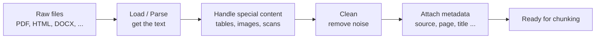

# 03 - Data Ingestion: Loading, Parsing, Cleaning and Metadata

> When I started with RAG, I thought the exciting parts were embeddings and the LLM, and that loading a PDF was a one-line job. I was wrong. Most of the bad answers I saw early on came from **bad text going in**, not from a weak model. If the PDF is read badly, nothing later in the pipeline can fix it. This chapter is about getting clean, well-labeled text out of real documents.

**What you'll understand after this chapter**

- Why ingestion quality decides RAG quality
- How to load PDFs, HTML, Word files, and other formats
- How to handle tables, scanned documents (OCR), and multi-column layouts
- How to clean messy text
- What metadata to save and why
- How to check that your parsing is actually good

---

## 1. Why Ingestion Matters So Much

There is an old saying in data work: **garbage in, garbage out**. For RAG it is very true.

Here is what a badly parsed PDF can do:

| What goes wrong while reading | What happens later |
|---|---|
| Text from two columns gets mixed line by line | Chunks make no sense, retrieval matches nonsense |
| A table turns into a pile of numbers with no headers | The model can't tell which number belongs to which column |
| A scanned page gives empty text | That page is invisible to the chatbot |
| Page headers and footers are repeated everywhere | Every chunk contains the same junk, so searches match useless text |
| Words are broken by hyphens ("informa-\ntion") | Embeddings and keyword search both get confused |

The embedding model, the vector database, and the LLM all work with whatever text you give them. They can't know the original page looked different.

> **My rule now:** before tuning anything else, open the extracted text and read it with my own eyes.

---

## 2. What Ingestion Includes



Four jobs: **extract the text, handle tricky content, clean it, and label it.**

---

## 3. Loading Different File Types

Documents come in many formats. Each needs a slightly different tool.

| Format | Common tools | Notes |
|---|---|---|
| **PDF (text-based)** | `pypdf`, `PyMuPDF`, `pdfplumber` | Most common case |
| **PDF (scanned)** | OCR: `pytesseract`, `EasyOCR` | Pages are images, not text |
| **Word (.docx)** | `python-docx` | Keeps headings and tables fairly well |
| **HTML / web pages** | `BeautifulSoup`, `trafilatura` | Must remove menus, ads, scripts |
| **Markdown / TXT** | Plain file reading | Easiest |
| **CSV / Excel** | `pandas` | Rows need to be turned into readable sentences |
| **Mixed formats** | `Unstructured`, LangChain loaders | One tool for many types |

### 3.1 PDFs: the most common case

**Simple option with `pypdf`:**

```python
from pypdf import PdfReader

def load_pdf_pypdf(path):
    reader = PdfReader(path)
    pages = []
    for i, page in enumerate(reader.pages):
        pages.append({
            "text": page.extract_text() or "",
            "page": i + 1,
            "source": path,
        })
    return pages
```

**Often better option with `PyMuPDF`:** it is fast and usually handles reading order and layout more carefully.

```python
import fitz  # this is PyMuPDF

def load_pdf_pymupdf(path):
    doc = fitz.open(path)
    pages = []
    for i, page in enumerate(doc):
        pages.append({
            "text": page.get_text(),
            "page": i + 1,
            "source": path,
        })
    return pages
```

Different PDFs behave differently with different tools. I learned to **try two parsers on the same difficult PDF and compare** instead of assuming one is always best.

### 3.2 HTML and web pages

Web pages are full of things we don't want: navigation menus, ads, cookie banners, footers.

```python
from bs4 import BeautifulSoup

def load_html(html_string, url):
    soup = BeautifulSoup(html_string, "html.parser")

    # remove things that are not real content
    for tag in soup(["script", "style", "nav", "footer", "header", "aside"]):
        tag.decompose()

    text = soup.get_text(separator="\n")
    title = soup.title.string if soup.title else ""
    return [{"text": text, "title": title, "source": url}]
```

For serious web scraping, libraries like `trafilatura` are built to pull out only the main article text.

### 3.3 Word files

```python
from docx import Document

def load_docx(path):
    doc = Document(path)
    text = "\n".join(p.text for p in doc.paragraphs if p.text.strip())
    return [{"text": text, "source": path}]
```

Headings in Word files are useful. They tell us the structure of the document, and we can use that later for smarter chunking.

### 3.4 One loader that picks the right tool

A small router keeps the rest of the code simple:

```python
from pathlib import Path

def load_document(path):
    ext = Path(path).suffix.lower()
    if ext == ".pdf":
        return load_pdf_pymupdf(path)
    elif ext == ".docx":
        return load_docx(path)
    elif ext in (".txt", ".md"):
        return [{"text": Path(path).read_text(encoding="utf-8"), "source": path}]
    else:
        raise ValueError(f"Unsupported file type: {ext}")
```

---

## 4. Tricky Content

### 4.1 Tables

Tables are one of the hardest parts of PDFs. A normal text extractor reads a table row by row as plain text, and the column structure is lost.

For example, a table like this:

| Plan | Price | Refund window |
|---|---|---|
| Basic | 10 | 7 days |
| Premium | 25 | 14 days |

can turn into: `Plan Price Refund window Basic 10 7 days Premium 25 14 days`. Now the model can't tell whether "14 days" belongs to Basic or Premium.

**A better approach with `pdfplumber`:**

```python
import pdfplumber

def extract_tables(path):
    results = []
    with pdfplumber.open(path) as pdf:
        for i, page in enumerate(pdf.pages):
            for table in page.extract_tables():
                results.append({"table": table, "page": i + 1})
    return results
```

Then convert each table into **Markdown text**, which keeps the structure and is easy for an LLM to read:

```python
def table_to_markdown(table):
    header, *rows = table
    lines = ["| " + " | ".join(str(c) for c in header) + " |"]
    lines.append("|" + "---|" * len(header))
    for row in rows:
        lines.append("| " + " | ".join(str(c) for c in row) + " |")
    return "\n".join(lines)
```

**Tips I follow for tables:**

- Keep a table **in one piece** when chunking. Don't split it in the middle.
- Save a note in the metadata that the chunk is a table (`"type": "table"`).
- Some tables are very hard. Tools like `Camelot` or `Unstructured`, or a vision-capable LLM, can help for complex layouts.

### 4.2 Scanned documents and OCR

A scanned PDF is just pictures of pages. A normal extractor returns empty text. The fix is **OCR (Optical Character Recognition)**, which reads text from images.

**First, detect the problem:**

```python
def looks_scanned(page_text, min_chars=30):
    return len(page_text.strip()) < min_chars
```

**Then run OCR on those pages:**

```python
import pytesseract
from pdf2image import convert_from_path

def ocr_pdf(path):
    images = convert_from_path(path)         # each page becomes an image
    pages = []
    for i, img in enumerate(images):
        text = pytesseract.image_to_string(img)
        pages.append({"text": text, "page": i + 1, "source": path})
    return pages
```

Things to know:

- `pytesseract` needs the **Tesseract program** installed on your machine, and `pdf2image` needs **Poppler**. They are not just `pip install` packages.
- OCR makes mistakes, especially on blurry scans, handwriting, or unusual fonts. A 0 can become an O.
- OCR is **slow**, so run it only on pages that need it.
- Newer options like cloud OCR services or vision-language models can be more accurate on hard pages.

### 4.3 Multi-column layouts

Research papers and newsletters often have two columns. A naive extractor reads straight across both columns, mixing the sentences. Signs of this problem: sentences that suddenly jump to a different topic mid-line.

What helps:

- Try a parser that follows reading order (PyMuPDF often does better than basic tools)
- Use layout-aware tools such as `Unstructured`
- As always, **look at the output**

### 4.4 Images, charts, and diagrams

Text extractors ignore images. If important information lives in charts or diagrams, you can:

- Ignore them (fine if the text explains them)
- Run OCR on the image
- Ask a vision-capable model to describe the image, then store that description as text

This is part of **multimodal RAG**, which comes up again in the advanced chapter.

### 4.5 Spreadsheets and CSV

A row like `12, Premium, 25, 14` means nothing alone. Turn rows into sentences or keep the column names with the values:

```python
import pandas as pd

def csv_to_texts(path):
    df = pd.read_csv(path)
    texts = []
    for _, row in df.iterrows():
        texts.append(", ".join(f"{col}: {val}" for col, val in row.items()))
    return texts
# "Plan: Premium, Price: 25, Refund window: 14 days"
```

---

## 5. Cleaning the Text

Once the text is extracted, it still needs cleaning. Here are the problems I run into most and how I deal with them.

### 5.1 Extra whitespace and line breaks

```python
import re

def normalize_whitespace(text):
    text = re.sub(r"[ \t]+", " ", text)       # many spaces -> one
    text = re.sub(r"\n{3,}", "\n\n", text)     # many blank lines -> one
    return text.strip()
```

Be careful: if you flatten **all** newlines, you lose paragraph boundaries, and paragraphs are useful for chunking. Keep a blank line between paragraphs when you can.

### 5.2 Words broken across lines

PDFs often break words with a hyphen at the end of a line: `informa-\ntion`.

```python
def fix_hyphenation(text):
    return re.sub(r"(\w)-\n(\w)", r"\1\2", text)
```

### 5.3 Repeated headers and footers

If every page has "Company Confidential - Page 4" at the top, that sentence will end up inside many chunks and add noise. A simple trick is to find lines that repeat on many pages and remove them:

```python
from collections import Counter

def remove_repeated_lines(pages, min_fraction=0.5):
    line_counts = Counter()
    for p in pages:
        for line in set(p["text"].split("\n")):
            line_counts[line.strip()] += 1

    threshold = len(pages) * min_fraction
    repeated = {l for l, c in line_counts.items() if l and c >= threshold}

    for p in pages:
        p["text"] = "\n".join(
            l for l in p["text"].split("\n") if l.strip() not in repeated
        )
    return pages
```

This works for short, simple repeated lines. Page numbers change every page, so they need a pattern (like a regex) instead.

### 5.4 Strange characters

```python
import unicodedata

def normalize_unicode(text):
    text = unicodedata.normalize("NFKC", text)   # fixes ligatures like "fi" -> "fi"
    text = text.replace("\u00a0", " ")           # non-breaking space
    return text
```

### 5.5 Putting it together

```python
def clean_text(text):
    text = normalize_unicode(text)
    text = fix_hyphenation(text)
    text = normalize_whitespace(text)
    return text
```

### What NOT to clean

I made this mistake once, so I'm writing it down: **don't over-clean.**

- Don't remove numbers, units, or punctuation that carry meaning ("$25", "14 days", "not")
- Don't lowercase everything or strip stop words. That was needed for old keyword methods, but modern embedding models work better with natural text.
- Don't delete things you haven't looked at.

Clean the obvious noise, and leave the actual content alone.

---

## 6. Metadata: Labeling Your Text

**Metadata** is information *about* the text, such as where it came from. It does not get embedded, but it travels with each chunk.

### 6.1 What to store

| Field | Example | Why it's useful |
|---|---|---|
| `source` | `hr_handbook.pdf` | Citations, deleting or updating a file |
| `page` | `12` | "See page 12" in the answer |
| `title` | `Leave Policy` | Context and display |
| `section` | `3.2 Annual Leave` | Better citations, structure-aware chunking |
| `doc_id` | `a3f9...` | Unique ID for updates and deduplication |
| `type` | `text`, `table`, `image_caption` | Treat content types differently |
| `date` / `version` | `2025-01-10` | Prefer newer documents, filter by time |
| `language` | `en` | Route to the right model |
| `access_level` / `owner` | `hr_only` | Security: filter by user permissions |
| `chunk_index` | `7` | Fetch neighbouring chunks |

### 6.2 Why metadata is worth the effort

1. **Citations.** "According to hr_handbook.pdf, page 12..." builds trust.
2. **Filtering.** Search only inside one document, one year, or one department.
3. **Updating.** Find and delete all chunks from an outdated file.
4. **Security.** Make sure users only retrieve what they are allowed to see.
5. **Debugging.** When an answer is wrong, you can see exactly where the chunk came from.

### 6.3 Adding metadata in code

```python
import hashlib
from pathlib import Path

def file_hash(path):
    return hashlib.sha256(Path(path).read_bytes()).hexdigest()

def build_records(path):
    doc_id = file_hash(path)
    records = []
    for page in load_pdf_pymupdf(path):
        records.append({
            "text": clean_text(page["text"]),
            "metadata": {
                "source": Path(path).name,
                "page": page["page"],
                "doc_id": doc_id,
                "type": "text",
            },
        })
    return records
```

The file hash is handy. If you re-run ingestion and the hash is the same, you know the file didn't change and you can skip it. If it differs, re-ingest it.

---

## 7. A Complete Ingestion Function

```python
def ingest_files(paths):
    all_records = []
    for path in paths:
        pages = load_document(path)

        # OCR fallback for scanned pages
        for p in pages:
            if looks_scanned(p["text"]):
                print(f"Warning: page {p.get('page')} of {path} looks scanned. Consider OCR.")

        pages = remove_repeated_lines(pages)

        for p in pages:
            text = clean_text(p["text"])
            if not text:
                continue                       # skip empty pages
            all_records.append({
                "text": text,
                "metadata": {
                    "source": Path(path).name,
                    "page": p.get("page"),
                    "type": "text",
                },
            })
    return all_records
```

The output is a list of clean, labeled records, ready for the next step: chunking.

---

## 8. Checking Your Ingestion Quality

I don't trust the pipeline until I've checked its output. A few quick habits:

1. **Print and read.** Look at the first 500 characters of a few pages. Does it read like the original?
2. **Count characters per page.** Pages with almost no text are probably scanned or failed.
3. **Compare two parsers** on a hard document.
4. **Check tables by hand.** Is each value still under the right column?
5. **Search for a known sentence** from the PDF in your extracted text. If it's not there, something was lost.

```python
for r in all_records[:3]:
    print(r["metadata"])
    print(r["text"][:500])
    print("-" * 40)
```

This takes a few minutes and saves a lot of confusion later.

---

## 9. Choosing a Tool: Quick Guide

| Situation | What I'd try first |
|---|---|
| Clean, simple text PDFs | `PyMuPDF` or `pypdf` |
| PDFs with tables | `pdfplumber`, then convert to Markdown |
| Scanned PDFs | OCR with `pytesseract` or a cloud OCR service |
| Many file types in one project | `Unstructured` or LangChain loaders |
| Complex layouts (papers, forms, invoices) | Layout-aware parsers or a vision-capable model |
| Web pages | `trafilatura` or `BeautifulSoup` |

There is no single best tool. The right one depends on your documents, so test on your own files.

---

## 10. Common Mistakes

- **Never looking at the extracted text.** Always read a sample.
- **Ignoring scanned pages**, so part of the document silently goes missing.
- **Throwing away page numbers and sources**, then having no citations.
- **Over-cleaning**, such as removing numbers or punctuation that matter.
- **Splitting tables across chunks** (we'll handle this in chunking).
- **No deduplication**, so the same document is ingested twice and gives duplicate results.
- **Forgetting access control** until the end, when it is much harder to add.

---

## 11. Key Takeaways

1. **Ingestion quality sets the ceiling for RAG quality.** Bad text in means bad answers out.
2. Use the **right loader for each format**, and try more than one parser on difficult PDFs.
3. **Tables, scans, and multi-column pages** need special care. Convert tables to Markdown and use OCR for scanned pages.
4. **Clean the noise** (extra spaces, broken words, repeated headers), but don't over-clean the real content.
5. **Metadata** (source, page, type, doc ID, access level) enables citations, filtering, updates, and security.
6. **Always inspect your output** before moving on.

---

## 12. Quick Self-Check

1. Why can a perfect embedding model still give poor answers if ingestion is bad?
2. How do you tell if a PDF page is scanned, and what do you do about it?
3. Why is a table risky to read as plain text? How would you fix it?
4. Give three metadata fields you'd store and what each is used for.
5. Why might you want a file hash for each document?

---


