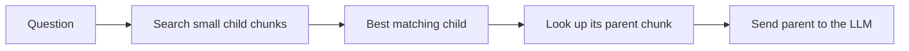

# 04 - Chunking: Splitting Documents the Right Way

> Chunking sounds boring. You just cut text into pieces, right? But in my experience this is one of the choices that changes RAG results the most. The same documents, the same embedding model, and the same LLM can give very different answers depending only on how the text was cut. This chapter explains the main chunking methods in simple words, with code and the trade-offs I try to keep in mind.

**What you'll understand after this chapter**

- Why we need to chunk at all
- What goes wrong when chunks are too big or too small
- The main strategies: fixed-size, recursive, sentence-based, structure-aware, semantic, and parent-child
- How to choose chunk size and overlap
- How to test your chunking instead of guessing

---

## 1. Why Do We Chunk?

We can't embed or retrieve a whole 300-page book as one item. Three reasons:

1. **The context window is limited.** We can only put a few pieces of text in the prompt.
2. **Embeddings get blurry on long text.** One vector for a whole chapter becomes an average of many topics, so it matches nothing well.
3. **Cost and speed.** Sending less text to the LLM is cheaper and faster.

So we cut documents into smaller pieces called **chunks**. Each chunk becomes one vector, and the retriever finds the chunks that match the question.

> **Think of it this way:** a chunk is the unit of knowledge your system can find. If the answer is split across two chunks, or buried in a huge chunk full of other things, your retriever has a hard time.

---

## 2. The Core Trade-Off: Too Big vs Too Small

This is the most important idea in the chapter.

| | **Small chunks** (for example 100 to 200 tokens) | **Large chunks** (for example 800 to 1500 tokens) |
|---|---|---|
| **Search precision** | High. Each chunk is about one thing | Low. Many topics mixed together |
| **Context** | Often missing. The sentence loses its surroundings | Rich. Full explanation is included |
| **Noise sent to the LLM** | Low | High |
| **Number of chunks** | Many (bigger index) | Fewer |
| **Risk** | Answer is cut across chunks, or pronouns like "it" lose meaning | Embedding is diluted, retrieval misses |

An example. Imagine a paragraph:

> "The Premium plan costs 25 dollars a month. It includes priority support. Refunds are available within 14 days."

- If the chunk is **just the last sentence**, "Refunds are available within 14 days" has no idea which plan it talks about.
- If the chunk is **a full 5-page section about all plans**, the vector is a mix of everything, and a question about Premium refunds may not match strongly.

The sweet spot depends on your documents and your questions. There is no universal number, but a **common starting range is roughly 200 to 500 tokens** with some overlap, and then you test.

---

## 3. Characters or Tokens?

Chunk sizes can be measured in characters, words, or tokens.

- **Characters** are simple, but a character count doesn't match what the model sees.
- **Tokens** match what the embedding model and the LLM actually count. Embedding models also have a **maximum input length**, and text beyond it is cut off and ignored.

Rough guide for English: 1 token is about 4 characters. So 500 characters is about 125 tokens.

```python
import tiktoken

enc = tiktoken.get_encoding("cl100k_base")

def count_tokens(text):
    return len(enc.encode(text))
```

Check your embedding model's maximum input length (many small models handle roughly 256 to 512 tokens, but it varies by model). A chunk longer than that is silently truncated, which means part of your text is never represented in the vector.

---

## 4. Chunk Overlap

**Overlap** means the end of one chunk is repeated at the start of the next.

```
Chunk 1:  [ A A A A A A A A ]
Chunk 2:           [ A A | B B B B B B ]
                    ^^^^ overlap
```

Why it helps: a sentence or idea sitting at the boundary won't be cut in half and lost.

Why too much hurts: you store the same text many times, the index gets bigger, and the retriever may return near-duplicate chunks.

A common starting point is **10 to 20% overlap**. For 500-token chunks, that's about 50 to 100 tokens.

---

## 5. Chunking Strategies

### 5.1 Fixed-size chunking

Cut every N characters (or tokens), with overlap. The simplest method.

```python
def fixed_chunks(text, chunk_size=500, overlap=100):
    chunks, start = [], 0
    while start < len(text):
        chunks.append(text[start:start + chunk_size])
        start += chunk_size - overlap
    return chunks
```

**Good:** very simple, fast, predictable sizes.
**Bad:** cuts through words, sentences, and paragraphs without caring. Often splits an idea in the middle.
**Use when:** quick prototypes, very uniform text.

### 5.2 Recursive chunking (a good default)

This method tries to split on natural boundaries, in order: first paragraphs, then lines, then sentences, then words. It only moves to a smaller separator if the piece is still too big.

```python
from langchain_text_splitters import RecursiveCharacterTextSplitter

splitter = RecursiveCharacterTextSplitter(
    chunk_size=500,
    chunk_overlap=100,
    separators=["\n\n", "\n", ". ", " ", ""],
)
chunks = splitter.split_text(text)
```

**Good:** respects the natural structure of text, works well on most documents, easy to use.
**Bad:** still doesn't understand meaning. It only looks at separators.
**Use when:** you want a strong default. This is where I start almost every project.

To measure size in tokens instead of characters:

```python
splitter = RecursiveCharacterTextSplitter.from_tiktoken_encoder(
    chunk_size=400,
    chunk_overlap=50,
)
```

### 5.3 Sentence-based chunking

Split into sentences, then group a few sentences together up to a size limit. Chunks always begin and end at sentence boundaries.

```python
import re

def sentence_chunks(text, max_chars=500):
    sentences = re.split(r"(?<=[.!?])\s+", text)
    chunks, current = [], ""
    for s in sentences:
        if len(current) + len(s) > max_chars and current:
            chunks.append(current.strip())
            current = ""
        current += s + " "
    if current.strip():
        chunks.append(current.strip())
    return chunks
```

(For real projects, a proper sentence splitter from `nltk` or `spaCy` handles abbreviations like "Dr." better than a simple regex.)

**Good:** clean boundaries, easy to read.
**Bad:** sentence lengths vary, so chunk sizes vary.
**Use when:** text is made of clear sentences, like articles and reports.

### 5.4 Structure-aware (document-based) chunking

Many documents already have structure: headings, sections, lists, tables, code blocks. We can use that structure instead of ignoring it.

For Markdown:

```python
from langchain_text_splitters import MarkdownHeaderTextSplitter

headers = [("#", "h1"), ("##", "h2"), ("###", "h3")]
splitter = MarkdownHeaderTextSplitter(headers_to_split_on=headers)
docs = splitter.split_text(markdown_text)

# each chunk keeps its headers in metadata, e.g. {"h1": "Policies", "h2": "Refunds"}
```

Splitting by headings keeps one topic per chunk, and the heading path becomes useful metadata for citations.

Other examples:

- **HTML:** split by `<h1>`, `<h2>`, `<section>` tags
- **Code:** split by function or class
- **Legal or policy documents:** split by clause or article number
- **Tables:** keep each table as one chunk (never split a table in the middle)
- **Q&A / FAQ pages:** one question and its answer per chunk

**Good:** chunks match how the author organized the ideas.
**Bad:** needs documents with reliable structure, and PDFs often lose it during extraction.
**Use when:** the structure is available. It is often the best-quality option.

### 5.5 Semantic chunking

Instead of using size or separators, split where the **meaning changes**. The idea:

1. Split the text into sentences
2. Embed each sentence
3. Compare each sentence with the next one
4. Where the similarity drops sharply, start a new chunk

```python
import re
import numpy as np
from sentence_transformers import SentenceTransformer

model = SentenceTransformer("all-MiniLM-L6-v2")

def semantic_chunks(text, threshold=0.5):
    sentences = re.split(r"(?<=[.!?])\s+", text)
    vectors = model.encode(sentences, normalize_embeddings=True)

    chunks, current = [], [sentences[0]]
    for i in range(1, len(sentences)):
        similarity = float(vectors[i - 1] @ vectors[i])
        if similarity < threshold:               # topic changed
            chunks.append(" ".join(current))
            current = []
        current.append(sentences[i])
    chunks.append(" ".join(current))
    return chunks
```

The threshold here is just an example. In practice you tune it, or use a percentile of the similarity scores. Some libraries (for example LangChain's experimental `SemanticChunker`) do this for you.

**Good:** chunks follow topics, not arbitrary lengths.
**Bad:** slower (needs embeddings at ingestion), threshold needs tuning, chunk sizes vary a lot, and it doesn't always beat a well-tuned recursive splitter. Some studies and practitioners report only small gains for the extra cost, so **test it on your own data** instead of assuming.
**Use when:** documents with long, mixed-topic text, and you have measured a benefit.

### 5.6 Parent-child (small-to-big) chunking

This one solved a real tension for me. Small chunks are better for **finding** the answer, and large chunks are better for **understanding** it. Why not use both?

**Idea:**

- Split the document into large **parent** chunks (for example a full section)
- Split each parent into small **child** chunks
- **Embed and search the children** (precise matching)
- When a child matches, **return its parent** to the LLM (full context)



```python
parent_splitter = RecursiveCharacterTextSplitter(chunk_size=2000, chunk_overlap=200)
child_splitter  = RecursiveCharacterTextSplitter(chunk_size=400,  chunk_overlap=50)

parents = parent_splitter.split_text(text)

children, parent_lookup = [], {}
for p_id, parent in enumerate(parents):
    parent_lookup[p_id] = parent
    for child in child_splitter.split_text(parent):
        children.append({"text": child, "parent_id": p_id})

# 1. embed and index only the children
# 2. at query time: find top child chunks
# 3. map each to child["parent_id"] and send parent_lookup[parent_id] to the LLM
#    (remove duplicates if several children share the same parent)
```

**Good:** precise search plus rich context.
**Bad:** more complex, needs a place to store parents, and parents are bigger, so they use more tokens.
**Use when:** answers need surrounding context. LangChain and LlamaIndex both have built-in versions of this idea (a "parent document retriever" and "auto-merging retrieval").

A close cousin is **sentence-window retrieval**: embed single sentences, and at retrieval time return the sentence plus a few sentences before and after it.

---

## 6. Don't Lose the Metadata

Each chunk should carry the metadata from the ingestion step, plus a bit more:

```python
def make_chunks(record, splitter):
    pieces = splitter.split_text(record["text"])
    chunks = []
    for i, piece in enumerate(pieces):
        chunks.append({
            "text": piece,
            "metadata": {
                **record["metadata"],       # source, page, doc_id, type...
                "chunk_index": i,
                "chunk_tokens": count_tokens(piece),
            },
        })
    return chunks
```

`chunk_index` is useful because you can later fetch the neighboring chunks when a chunk looks cut off.

---

## 7. How to Choose: A Practical Guide

| Situation | A good first choice |
|---|---|
| Not sure, general documents | Recursive, about 300 to 500 tokens, 10 to 15% overlap |
| Markdown, HTML, structured docs | Structure-aware by headings |
| FAQs, short entries | One entry per chunk |
| Tables | Keep each table whole |
| Code | Split by function or class |
| Answers need wide context | Parent-child or sentence-window |
| Mixed-topic long text, and you can measure a gain | Semantic |

Also think about the **type of questions** your users ask:

- **Factual lookups** ("What is the refund window?") work better with smaller chunks.
- **Explanations and summaries** ("Explain the leave policy") need larger chunks or parent-child.

---

## 8. Test Your Chunking, Don't Guess

This is the habit that separates a guess from an engineering decision. Build a small test set of questions where you **know which page or passage holds the answer**, then compare chunk settings.

```python
def retrieval_hit_rate(eval_set, retrieve_fn, k=4):
    """eval_set: [{"question": "...", "answer_snippet": "14 days"}, ...]"""
    hits = 0
    for item in eval_set:
        results = retrieve_fn(item["question"], k)
        if any(item["answer_snippet"].lower() in r["text"].lower() for r in results):
            hits += 1
    return hits / len(eval_set)

for size, overlap in [(200, 20), (400, 50), (800, 100)]:
    # 1. re-chunk with these settings
    # 2. re-embed and rebuild the index
    # 3. measure
    # score = retrieval_hit_rate(eval_set, retrieve_fn)
    # print(size, overlap, score)
    pass
```

Put 15 to 30 real questions in the test set. Even a small set will show clear differences. Save the results in a table. They are a great portfolio item, for example:

| Chunk size | Overlap | Hit rate @4 |
|---|---|---|
| 200 | 20 | (your result) |
| 400 | 50 | (your result) |
| 800 | 100 | (your result) |

(The full evaluation methods come in [13 - Evaluation](./13-evaluation.md).)

---

## 9. Common Mistakes

- **Using the default size without testing.** The best size depends on your data.
- **Chunks longer than the embedding model's limit**, so the end of each chunk is silently ignored.
- **Cutting tables, code blocks, or lists in the middle.**
- **Zero overlap** on text where ideas run across boundaries.
- **Huge overlap** that fills the index with near-duplicates.
- **Losing metadata** during splitting, so there are no citations.
- **Chunks with no context**, like "It costs 25 dollars" where nobody knows what "it" is.
- **Changing the chunking and forgetting to re-embed.** Any chunking change means rebuilding the index.

---

## 10. Key Takeaways

1. Chunking decides **what your retriever is able to find**. It strongly affects answer quality.
2. **Small chunks** are precise but lose context. **Large chunks** have context but blur the match.
3. **Recursive chunking** is a strong default. **Structure-aware** is often best when structure exists.
4. **Parent-child** gives you both: search small, answer with large.
5. Use **overlap** (about 10 to 20%) so ideas on the boundaries aren't lost.
6. Keep chunk length within the embedding model's input limit, and keep **metadata** on every chunk.
7. **Test different settings** on your own questions. Don't rely on a rule of thumb.

---

## 11. Quick Self-Check

1. Why can't we just embed a whole document as one vector?
2. What goes wrong with chunks that are too small? Too large?
3. What does overlap do, and what is the cost of too much of it?
4. Explain parent-child chunking in two sentences.
5. How would you decide between 300-token and 800-token chunks for your project?

---


