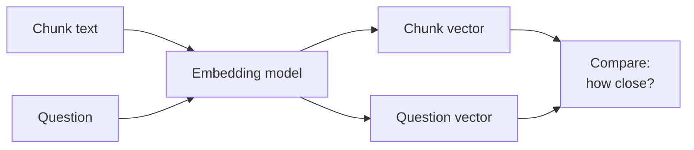

# 05 - Embeddings: Turning Text into Numbers That Carry Meaning

> Embeddings are the part of RAG that felt like magic to me at first. Two sentences with completely different words can end up "close" to each other, and the computer somehow knows they mean the same thing. This chapter explains how that works in simple words, how to pick an embedding model, and the small details (dimensions, similarity metrics, prefixes) that quietly affect your results.

**What you'll understand after this chapter**

- What an embedding is and how a model creates one
- Why embeddings capture meaning, and where they fail
- How to choose an embedding model
- How similarity is measured (cosine, dot product, L2)
- What dimensions mean and how they affect storage and speed
- Practical details: query vs document, batching, and testing

---

## 1. What Is an Embedding?

An **embedding** is a list of numbers (a vector) that represents a piece of text. The key rule:

> **Texts with similar meaning get vectors that are close together.**

```
"How do I reset my password?"     -> [0.12, -0.45, 0.88, ...]
"I forgot my login credentials"   -> [0.10, -0.41, 0.90, ...]   (close)
"Best pizza places in Rome"       -> [-0.70, 0.22, 0.05, ...]   (far)
```

In RAG we embed **every chunk** during ingestion and **the question** at query time. Then finding relevant text becomes simple geometry: *find the chunk vectors nearest to the question vector.*



---

## 2. How Does a Model Create Embeddings?

I won't go deep into the math, but the rough idea helped me trust the process.

1. **Tokenize** the text into tokens.
2. Pass the tokens through a **transformer** model. For each token it produces a vector that already takes the surrounding words into account. This is how "bank" gets different vectors in "river bank" and "bank account".
3. **Pool** those token vectors into **one** vector for the whole text, commonly by averaging them (some models use a special token instead).
4. Optionally **normalize** the vector so its length is 1.

### How does it learn meaning?

Mostly through **contrastive learning**. The model is shown pairs of texts that belong together (a question and its answer, a title and its article, two paraphrases) and is trained to:

- pull the vectors of matching pairs **closer**
- push the vectors of non-matching pairs **farther apart**

After training on a huge number of such pairs, the model learns a space where related meanings sit near each other. That is why a question can land near the passage that answers it, even without sharing many words.

### Dense vs sparse (a term you'll meet)

| | **Dense embeddings** | **Sparse vectors** (like TF-IDF / BM25) |
|---|---|---|
| Size | Fixed, small (e.g. 384 to 3072 numbers), mostly non-zero | Very long (one slot per word), mostly zeros |
| Captures | Meaning, synonyms, paraphrases | Exact words and keywords |
| Weakness | Can miss exact terms, IDs, rare names | Misses synonyms and paraphrases |

Everything in this chapter is about **dense** embeddings. Combining both kinds is called **hybrid search**, covered in [07 - Retrieval](./07-retrieval.md).

---

## 3. Making Embeddings in Code

### 3.1 With an open-source model (runs on your machine)

```python
from sentence_transformers import SentenceTransformer

model = SentenceTransformer("all-MiniLM-L6-v2")

chunks = [
    "Premium plan purchases can be refunded within 14 days.",
    "Employees get 24 days of paid leave per year.",
]

vectors = model.encode(chunks, normalize_embeddings=True)
print(vectors.shape)   # (2, 384): 2 texts, 384 numbers each
```

### 3.2 With an API (hosted model)

```python
from openai import OpenAI

client = OpenAI()   # reads the API key from the environment

response = client.embeddings.create(
    model="text-embedding-3-small",
    input=chunks,
)
vectors = [item.embedding for item in response.data]
print(len(vectors[0]))   # 1536 by default for this model
```

Other providers (Cohere, Google, Voyage, and others) work in a similar way.

### 3.3 Always batch

Embedding one chunk at a time is slow. Send many at once:

```python
vectors = model.encode(chunk_texts, batch_size=64, show_progress_bar=True,
                       normalize_embeddings=True)
```

For APIs, check the maximum number of inputs and tokens per request, and add retries for rate limits.

---

## 4. Similarity: How Do We Measure "Close"?

Once we have vectors, we need a number that says how similar two of them are.

| Metric | What it measures | Notes |
|---|---|---|
| **Cosine similarity** | The angle between vectors (ignores length) | Most common for text. Range -1 to 1, higher is more similar |
| **Dot product** | Angle and length together | Fast. Same ranking as cosine if vectors are normalized |
| **Euclidean (L2) distance** | Straight-line distance | Lower means closer. Same ranking as cosine if vectors are normalized |

```python
import numpy as np

def cosine(a, b):
    return np.dot(a, b) / (np.linalg.norm(a) * np.linalg.norm(b))

def dot(a, b):
    return np.dot(a, b)

def l2(a, b):
    return np.linalg.norm(np.array(a) - np.array(b))
```

### What I remember about this

- **If vectors are normalized** (length 1), cosine, dot product, and L2 all give the **same ranking**. This is why most tutorials normalize and then use the dot product, which is the fastest to compute.
- **Use the metric the model was trained for.** The model's documentation usually says which one to use. Using the wrong one can quietly hurt results.
- The **score value** (like 0.82) is not a universal "percent match". It depends on the model, so compare scores within one setup, not across different models.

---

## 5. Choosing an Embedding Model

There is no "best" model for everything. These are the things I look at.

### 5.1 What to compare

| Factor | Why it matters |
|---|---|
| **Retrieval quality** | The main thing. Look at benchmark scores (the MTEB leaderboard is the usual place) and, even better, test on your own data |
| **Max input length** | Text longer than this is cut off. It must fit your chunk size |
| **Dimensions** | Affects storage, memory, and search speed |
| **Speed / size** | Small models run fast on a laptop. Big ones may need a GPU |
| **Cost** | API models charge per token. Open-source models cost compute but no per-call fee |
| **Languages** | If your documents are in Hindi, French, or mixed languages, you need a multilingual model |
| **Domain** | Legal, medical, or code text may do better with a specialized model |
| **License and privacy** | Can the data leave your machine? Is the model licensed for commercial use? |

### 5.2 Open-source vs API

| | **Open-source (local)** | **API (hosted)** |
|---|---|---|
| Examples | `all-MiniLM-L6-v2`, BGE family, E5 family, GTE | OpenAI `text-embedding-3` models, Cohere Embed, Voyage, Google |
| Cost | Free per call, you pay for hardware | Pay per token |
| Privacy | Data stays with you | Data is sent to a provider |
| Setup | Need to manage the model | Just an API key |
| Control | Can fine-tune, pin a version | Provider may update or retire models |

Embedding models improve quickly and new ones appear often, so I treat any name list as a starting point. Check the current leaderboard and model cards instead of trusting an old blog post, including this one.

### 5.3 How I'd pick

1. Start with a **small, popular open-source model** (like MiniLM or a BGE small/base model) for a quick baseline.
2. Build a small **test set of questions** from your own documents.
3. Try **two or three candidate models** and measure retrieval on that test set.
4. Pick based on **quality, speed, cost, and privacy together**, not quality alone.

```python
def compare_models(model_names, chunks, eval_set, k=4):
    for name in model_names:
        model = SentenceTransformer(name)
        chunk_vecs = model.encode([c["text"] for c in chunks], normalize_embeddings=True)

        hits = 0
        for item in eval_set:                       # {"question": ..., "answer_snippet": ...}
            q_vec = model.encode([item["question"]], normalize_embeddings=True)[0]
            top_ids = np.argsort(chunk_vecs @ q_vec)[::-1][:k]
            if any(item["answer_snippet"].lower() in chunks[i]["text"].lower() for i in top_ids):
                hits += 1
        print(f"{name}: hit rate @ {k} = {hits / len(eval_set):.2f}")
```

A results table from this kind of test is a great item for your portfolio.

---

## 6. Dimensions

The **dimension** is how many numbers are in each vector (384, 768, 1024, 1536, 3072, and so on).

### What it affects

- **More dimensions** can hold more detail, but not always better results.
- **Storage and memory** grow in direct proportion.
- **Search speed** drops with larger vectors.

### A quick storage calculation

Each number is usually a 32-bit float, which is 4 bytes.

```
storage = number_of_chunks x dimensions x 4 bytes
```

For 1,000,000 chunks:

| Dimensions | Storage (approx.) |
|---|---|
| 384 | about 1.5 GB |
| 1536 | about 6.1 GB |
| 3072 | about 12.3 GB |

For a small PDF project this doesn't matter. For millions of chunks, it decides your hosting bill.

### Ways to reduce size

- **Pick a smaller model.** Often the simplest option.
- **Use shorter embeddings.** Some models (for example OpenAI's `text-embedding-3` models) let you ask for fewer dimensions, and some are trained so the first part of the vector still works on its own (called **Matryoshka embeddings**).

```python
response = client.embeddings.create(
    model="text-embedding-3-small",
    input=chunks,
    dimensions=512,          # shorter vector, slightly lower quality
)
```

- **Quantization.** Store numbers with fewer bits (for example 8-bit or even binary) to cut storage a lot, with a small drop in accuracy. Many vector databases support this.

Always test the quality drop on your own data before choosing a smaller size.

---

## 7. Practical Details That Matter

### 7.1 Query vs document prefixes

Some models are trained to treat a **question** and a **passage** differently, and they expect a prefix:

```python
# Example: models in the E5 family expect these prefixes
passages = ["passage: " + c for c in chunk_texts]
query    = "query: " + question
```

Other models use a special instruction text for queries (BGE models, for example, document a query instruction for retrieval). If you forget the prefix the model expects, results get worse without any error message. **Always read the model card.**

### 7.2 Use the same model for documents and queries

Vectors from different models are not comparable, even if they have the same dimension. Mixing models gives nonsense results. This also means that **changing the model means re-embedding all your chunks.**

### 7.3 Respect the maximum input length

If a chunk is longer than the model's limit, the extra text is silently dropped and the vector represents only the first part. Check the limit and keep chunks under it.

```python
print(model.max_seq_length)   # shows the limit for sentence-transformers models
```

### 7.4 Normalize consistently

If you decide to normalize (usually a good idea), do it for **both** documents and queries.

### 7.5 Cache and save your embeddings

Embedding is the slow, sometimes paid, part of ingestion. Save the vectors so you don't recompute them, and skip chunks you've already embedded (use the file hash or a chunk hash from the ingestion chapter).

```python
import numpy as np

np.save("chunk_vectors.npy", vectors)
vectors = np.load("chunk_vectors.npy")
```

---

## 8. What Embeddings Can and Can't Do

Embeddings are powerful, but I try to remember their limits.

| Limitation | Example |
|---|---|
| **"Related" is not "correct"** | A chunk about refund policy for Basic may score high for a question on Premium |
| **Exact terms and IDs** | Searching "Error E-4021" or a product code may fail, since the model captures meaning, not exact strings |
| **Negation** | "The drug is safe" and "The drug is not safe" can end up very close |
| **Numbers and dates** | "14 days" and "40 days" look similar to many models |
| **Short, vague queries** | "policy" matches too many things |
| **Language mismatch** | A English-only model on Hindi text gives poor results |
| **Domain-specific jargon** | General models may not know specialized terms |

These weaknesses are exactly why later chapters add **hybrid search** (embeddings plus keywords), **reranking**, and **metadata filters**. Embeddings are the first stage of finding information, not the whole answer.

---

## 9. Quick Sanity Test for Any Embedding Setup

Before building on top of it, I run a quick check:

```python
pairs = [
    ("How do I reset my password?", "I forgot my login credentials"),     # should be HIGH
    ("How do I reset my password?", "Best pizza places in Rome"),         # should be LOW
    ("The refund window is 14 days", "You can get your money back within two weeks"),  # HIGH
]

for a, b in pairs:
    va, vb = model.encode([a, b], normalize_embeddings=True)
    print(f"{float(va @ vb):.2f}  |  {a}  <->  {b}")
```

If the "similar" pairs don't score clearly higher than the "different" pair, something is wrong: wrong model, missing prefix, or wrong language.

---

## 10. Common Mistakes

- **Using different models for documents and queries.**
- **Forgetting the model's required prefix or instruction.**
- **Chunks longer than the model's limit**, so text is silently cut.
- **Choosing a model only from a leaderboard**, without testing on your own data.
- **Not normalizing**, or normalizing only one side.
- **Changing the model and not re-embedding.**
- **Using an English-only model for other languages.**
- **Embedding the same chunks again and again** instead of caching.
- **Reading similarity scores as percentages**, or comparing scores across different models.

---

## 11. Key Takeaways

1. An **embedding** is a vector that represents the meaning of text. Similar meaning means close vectors.
2. Models learn this by **contrastive training**: matching pairs are pulled together, non-matching pairs are pushed apart.
3. **Cosine similarity** is the usual measure. With **normalized vectors**, cosine, dot product, and L2 all rank the same.
4. Choose a model by **quality on your data, input length, dimensions, speed, cost, language, and privacy**, and test two or three candidates.
5. **More dimensions** means more storage and slower search, so it is a trade-off, not an automatic win.
6. Use the **same model** (and the right prefix) for documents and queries. Changing models means **re-embedding everything**.
7. Embeddings capture **meaning, not truth**. They struggle with exact terms, negation, and numbers, which is why we add other techniques later.

---

## 12. Quick Self-Check

1. In simple words, how does an embedding model learn that two different sentences mean the same thing?
2. Why do most people normalize embeddings and then use the dot product?
3. What happens if a chunk is longer than the model's maximum input length?
4. Why can't you embed documents with one model and questions with another?
5. Name two things embeddings are bad at, and one technique that helps.

---


