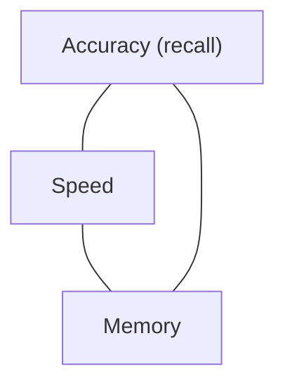
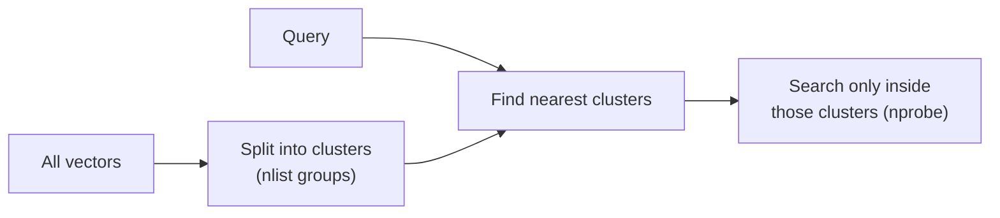
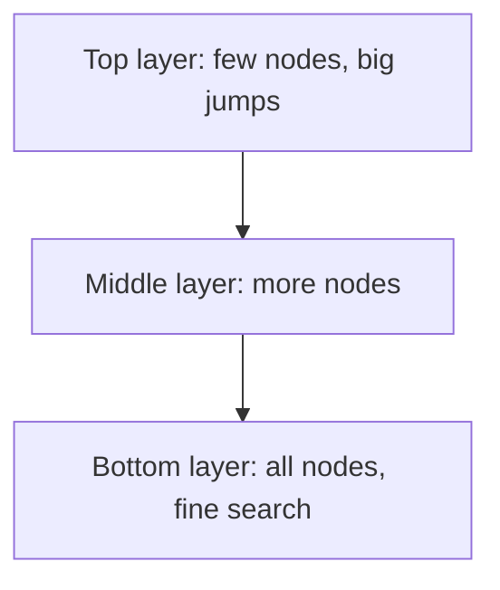
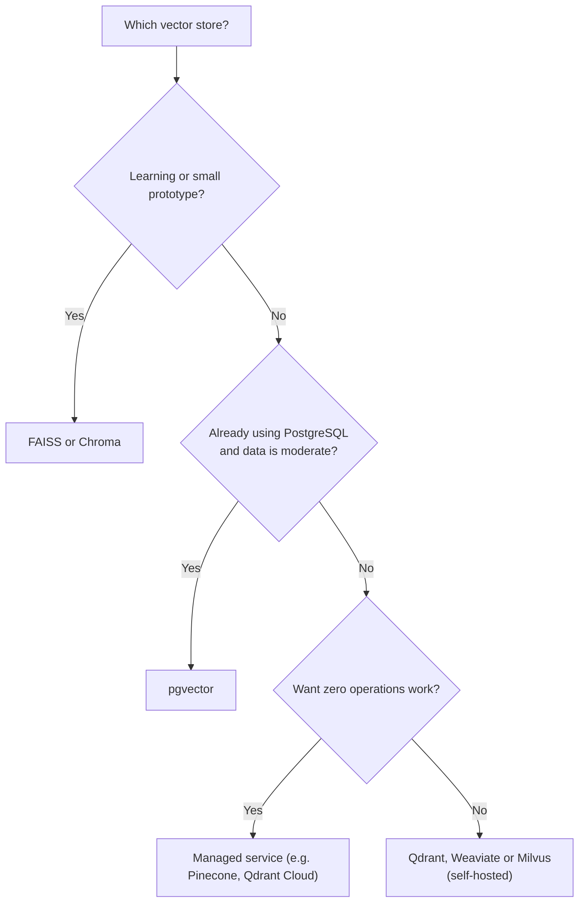

# 06 - Vector Databases: Where Embeddings Live and How We Search Them

> After creating embeddings, I had a simple question: where do I keep them, and how do I search them quickly? At first I just used a NumPy array and a dot product, and that worked fine for a few hundred chunks. Then I read about HNSW, IVF, and "approximate" search, and it sounded confusing. This chapter explains it the way I understood it: first the problem, then the idea behind each solution, then which tool to pick.

**What you'll understand after this chapter**

- What a vector database does and why we need one
- Exact search vs approximate search (ANN)
- How the main indexes work: Flat, IVF, HNSW, and compression (PQ)
- Differences between FAISS, Chroma, Qdrant, pgvector, and others
- Metadata filtering, updates, and deletes
- How to choose one for your project

---

## 1. What Is a Vector Database?

A vector database stores **vectors together with their text and metadata**, and can quickly answer one question:

> "Which stored vectors are closest to this query vector?"

For each chunk it keeps three things:

```
[ vector ]  +  [ chunk text ]  +  [ metadata: source, page, type, ... ]
```

The vector is used for searching. The text and metadata are what we return.

### Do I really need one?

For a small project, no. If you have a few thousand chunks, a NumPy array is enough:

```python
import numpy as np

scores = chunk_vectors @ query_vector          # similarity with every chunk
top_ids = np.argsort(scores)[::-1][:4]         # best 4
```

This is called **brute-force** or **exact** search, because it compares the query with every single vector. It is simple and perfectly accurate.

The problem is size. If you have 10 million chunks, comparing against all of them for every question is too slow. That is where vector databases and special indexes help.

A real vector database also gives you things a NumPy array doesn't:

| Feature | Why it helps |
|---|---|
| **Fast approximate search** | Handles millions of vectors in milliseconds |
| **Metadata filtering** | "Only search this document / year / department" |
| **Persistence** | Data is saved on disk, not lost when the program stops |
| **Add, update, delete** | Change data without rebuilding everything |
| **Scaling and replication** | Handles more data and more users |
| **Hybrid search** (in many) | Combine vectors with keyword search |
| **Access control** (in many) | Keep data separated per user or team |

---

## 2. Exact Search vs Approximate Search (ANN)

### Exact search (Flat)

Compare the query with every vector. Always finds the true nearest neighbors. Cost grows with the number of vectors.

### Approximate Nearest Neighbor (ANN)

Instead of checking everything, ANN uses a smart structure to check only a **small, promising part** of the data. It is much faster, but it may occasionally miss a true nearest neighbor.

Think of finding a book in a huge library:

- **Exact:** walk through every shelf and check every book.
- **ANN:** go to the right section first, then the right shelf, then look around there. You will almost always find it, much faster, but very rarely you might miss one just outside the area you checked.

### The three-way trade-off

Every ANN index balances three things, and you can't maximize all of them:



- Higher accuracy usually costs more time or memory.
- Faster search usually costs some accuracy.
- Lower memory usually costs accuracy or speed.

**Recall** is the word used for accuracy here: out of the true top-k results, what fraction did the ANN index return? A recall of 0.95 means it found 95 of the true top 100.

For RAG, a small recall loss is usually acceptable, because we only need the relevant chunks to be in the top few results.

---

## 3. The Main Index Types

### 3.1 Flat index

Stores all vectors as they are and does exact search.

```python
import faiss
import numpy as np

d = vectors.shape[1]                       # number of dimensions
index = faiss.IndexFlatIP(d)               # IP = inner product (use with normalized vectors)
index.add(np.array(vectors, dtype="float32"))

scores, ids = index.search(query_vec.astype("float32"), 4)
```

- **Accuracy:** perfect
- **Speed:** slows down as data grows
- **Memory:** raw vectors only
- **Use when:** up to roughly hundreds of thousands of vectors, or when you need a reference to measure other indexes against

### 3.2 IVF (Inverted File Index)

**Idea:** group the vectors into clusters, like sorting books into sections. At search time, find the few clusters closest to the query and search only inside them.



```python
nlist = 100                                         # number of clusters
quantizer = faiss.IndexFlatIP(d)
index = faiss.IndexIVFFlat(quantizer, d, nlist, faiss.METRIC_INNER_PRODUCT)

index.train(vectors)                                # IVF must learn the clusters first
index.add(vectors)

index.nprobe = 10                                   # how many clusters to check per search
scores, ids = index.search(query_vec, 4)
```

Two settings to know:

- **nlist:** how many clusters. More clusters means smaller groups.
- **nprobe:** how many clusters to search. Higher means better recall but slower.

**Good:** fast, memory-friendly, a classic choice for large data.
**Bad:** needs a training step, and if the answer sits in a cluster you didn't check, you miss it.

### 3.3 HNSW (Hierarchical Navigable Small World)

This is the most popular index in vector databases today, so it's worth understanding.

**Idea:** build a **graph** where each vector is connected to its close neighbors, with several layers.

- The **top layers** have few points and long-range links, like a highway map.
- The **bottom layer** has all points and short links, like local streets.

A search starts at the top, jumps quickly toward the right area using the highways, and then goes down layer by layer, getting more precise until it reaches the nearest neighbors.



```python
index = faiss.IndexHNSWFlat(d, 32, faiss.METRIC_INNER_PRODUCT)   # 32 = links per node (M)
index.hnsw.efConstruction = 200       # build quality: higher is better but slower to build
index.add(vectors)

index.hnsw.efSearch = 64              # search quality: higher is better but slower
scores, ids = index.search(query_vec, 4)
```

Three settings:

- **M:** number of connections per node. More means better recall and more memory.
- **efConstruction:** how carefully the graph is built.
- **efSearch:** how widely the search explores at query time. This is the knob you adjust to trade speed for recall.

**Good:** very fast, high recall, no training step, handles additions well.
**Bad:** uses more memory (the graph links are extra), and deleting vectors is awkward in many implementations.

### 3.4 Compression: Product Quantization (PQ)

When vectors are too big for memory, we can **compress** them. In PQ, each vector is cut into small parts, and each part is replaced by a short code from a learned codebook. A vector that took thousands of bytes can shrink to a few dozen bytes.

```python
# IVF + PQ in FAISS: 100 clusters, 8 sub-vectors, 8 bits each
quantizer = faiss.IndexFlatL2(d)
index = faiss.IndexIVFPQ(quantizer, d, 100, 8, 8)
index.train(vectors)
index.add(vectors)
```

**Good:** very large memory savings, so it can handle huge datasets.
**Bad:** some accuracy loss, and more tuning.
**Use when:** you have tens or hundreds of millions of vectors and memory is the problem. Most small RAG projects don't need it.

(There are also other methods, like scalar quantization, binary quantization, and disk-based indexes like DiskANN. Many vector databases offer them as options.)

### Quick comparison

| Index | Accuracy | Speed | Memory | Needs training? | Good for |
|---|---|---|---|---|---|
| **Flat** | Perfect | Slow on big data | Normal | No | Small data, baselines |
| **IVF** | Good (depends on nprobe) | Fast | Normal | Yes | Large data |
| **HNSW** | Very good | Very fast | Higher | No | Most general uses |
| **IVF + PQ** | Lower | Fast | Very low | Yes | Huge data, tight memory |

> **My rule of thumb:** start with Flat for small data. If you need speed, use HNSW. If memory is the problem, look at IVF with PQ or quantization.

---

## 4. Libraries vs Databases

People often mix these up, so here is the difference.

- **A library (like FAISS)** gives you the search algorithms. It is not a full database. You handle storing the text, the metadata, and saving to disk yourself.
- **A vector database (like Chroma, Qdrant, Weaviate, Milvus, Pinecone)** is a complete system with storage, metadata, filtering, an API, and often scaling.
- **Vector extensions for existing databases (like pgvector for PostgreSQL)** add vector search to a database you may already use.

---

## 5. Popular Options

### 5.1 FAISS (library)

Made by Meta. Very fast, many index types, supports GPUs.

```python
import faiss
import numpy as np

index = faiss.IndexHNSWFlat(d, 32, faiss.METRIC_INNER_PRODUCT)
index.add(np.array(vectors, dtype="float32"))

faiss.write_index(index, "chunks.index")     # save
index = faiss.read_index("chunks.index")     # load
```

You must keep your own list of chunks and metadata, in the **same order** as the vectors, because FAISS only returns positions:

```python
scores, ids = index.search(query_vec, 4)
results = [chunks[i] for i in ids[0]]
```

**Good:** fast, flexible, free, great for learning and prototypes.
**Bad:** no built-in metadata filtering, persistence, or server. You build those yourself.

### 5.2 Chroma

A simple, developer-friendly database that runs inside your Python app. Very popular for prototypes and small projects.

```python
import chromadb

client = chromadb.PersistentClient(path="./chroma_db")
collection = client.get_or_create_collection(
    name="docs",
    metadata={"hnsw:space": "cosine"},      # distance metric (check docs for your version)
)

collection.add(
    ids=[f"chunk_{i}" for i in range(len(chunks))],
    documents=[c["text"] for c in chunks],
    embeddings=vectors.tolist(),
    metadatas=[c["metadata"] for c in chunks],
)

results = collection.query(
    query_embeddings=[query_vec.tolist()],
    n_results=4,
    where={"source": "hr_handbook.pdf"},     # metadata filter
)

print(results["documents"][0])
print(results["metadatas"][0])
print(results["distances"][0])               # a distance, so lower is closer
```

**Good:** very easy, stores text and metadata together, supports filtering.
**Bad:** less suited to very large or heavily loaded production systems.

### 5.3 Qdrant

A vector database written in Rust, built for production. Strong filtering and good performance. Runs locally, in Docker, or as a cloud service.

```python
from qdrant_client import QdrantClient
from qdrant_client.models import (
    Distance, VectorParams, PointStruct, Filter, FieldCondition, MatchValue
)

client = QdrantClient(path="./qdrant_data")        # local mode; or QdrantClient(url="http://localhost:6333")

client.create_collection(
    collection_name="docs",
    vectors_config=VectorParams(size=384, distance=Distance.COSINE),
)

client.upsert(
    collection_name="docs",
    points=[
        PointStruct(id=i, vector=vectors[i].tolist(),
                    payload={"text": chunks[i]["text"], **chunks[i]["metadata"]})
        for i in range(len(chunks))
    ],
)

hits = client.query_points(
    collection_name="docs",
    query=query_vec.tolist(),
    limit=4,
    query_filter=Filter(must=[FieldCondition(key="source", match=MatchValue(value="hr_handbook.pdf"))]),
).points

for h in hits:
    print(h.score, h.payload["text"][:80])
```

(Method names change between versions, so check the current client docs.)

**Good:** strong metadata filtering, production-ready, flexible deployment.
**Bad:** a bit more setup than Chroma.

### 5.4 pgvector (PostgreSQL)

If you already use PostgreSQL, you can add vector search to it. Your vectors sit right next to your normal data.

```sql
CREATE EXTENSION IF NOT EXISTS vector;

CREATE TABLE chunks (
    id        bigserial PRIMARY KEY,
    content   text,
    source    text,
    page      int,
    embedding vector(384)
);

-- HNSW index for cosine distance
CREATE INDEX ON chunks USING hnsw (embedding vector_cosine_ops);

-- find the 4 closest chunks, with a normal SQL filter
SELECT content, source, page, 1 - (embedding <=> '[0.12, -0.45, ...]') AS similarity
FROM chunks
WHERE source = 'hr_handbook.pdf'
ORDER BY embedding <=> '[0.12, -0.45, ...]'
LIMIT 4;
```

The operators: `<=>` is cosine distance, `<->` is L2 distance, and `<#>` is negative inner product.

**Good:** one database for everything, full SQL (joins, transactions, permissions), no new system to run.
**Bad:** not as specialized or fast as dedicated vector databases at very large scale.

### 5.5 Others to know about

- **Pinecone:** fully managed cloud service. Very little operations work, but it is a paid hosted product.
- **Weaviate:** open-source database with built-in hybrid search and modules.
- **Milvus:** open-source, built for very large scale.
- **Elasticsearch / OpenSearch:** already used for keyword search, and they now support vector search too, which is convenient for hybrid search.
- **MongoDB Atlas, Redis, and others** also offer vector search features.

---

## 6. Comparison Table

| | **FAISS** | **Chroma** | **Qdrant** | **pgvector** | **Pinecone** |
|---|---|---|---|---|---|
| **Type** | Library | Database (embedded) | Database | Postgres extension | Managed cloud |
| **Setup** | Easy | Very easy | Easy to medium | Medium (needs Postgres) | Very easy |
| **Stores text + metadata** | No (you do it) | Yes | Yes (payload) | Yes (SQL columns) | Yes |
| **Metadata filtering** | Manual | Yes | Strong | Strong (SQL) | Yes |
| **Persistence** | Save and load files | Yes | Yes | Yes | Yes |
| **Best scale** | Large (with care) | Small to medium | Medium to large | Small to medium | Large |
| **Cost** | Free | Free | Free (self-host) or paid cloud | Free (with Postgres) | Paid |
| **Best for** | Learning, speed, custom setups | Prototypes, small apps | Production apps | Teams already on Postgres | Teams wanting zero operations |

### How I'd choose



This is a starting guide, not a rule. Think about your data size, the filtering you need, your team's skills, your budget, and where the data is allowed to live.

---

## 7. Metadata Filtering

Often you don't want to search everything. You want "only chunks from this PDF", "only documents from 2025", or "only what this user is allowed to see".

```python
# Chroma example
results = collection.query(
    query_embeddings=[query_vec.tolist()],
    n_results=4,
    where={"$and": [{"source": "hr_handbook.pdf"}, {"year": {"$gte": 2024}}]},
)
```

There are two ways a database can combine filtering with vector search:

- **Post-filtering:** find the nearest vectors first, then remove the ones that fail the filter. Risk: after filtering you may be left with too few results.
- **Pre-filtering / filtered search:** apply the filter during the search so you still get the requested number of matches. This is generally better, and good databases are designed to handle it well.

If filtering is important for your project (for example, per-user permissions), check how your chosen database handles it, because this is a real difference between tools.

---

## 8. Updates, Deletes, and Keeping Things in Sync

Documents change, so the vector store has to as well.

- **Give every chunk a stable ID** (for example `docid_chunkindex`). This makes updates and deletes possible.
- **Update a document:** delete all chunks with that `doc_id`, then insert the new ones.
- **Delete a document:** delete by filter on `doc_id` or `source`.
- **Plain FAISS indexes** don't handle this nicely. Some types support removal, HNSW generally doesn't, and the usual approach is to rebuild the index. A full database handles it for you.
- **Changed the embedding model?** Re-embed everything and rebuild the index.

```python
# Chroma: delete all chunks of one file, then re-add
collection.delete(where={"source": "hr_handbook.pdf"})
```

---

## 9. Measuring Your Index

Don't guess whether your ANN settings are good. Compare them with exact search:

```python
def recall_at_k(exact_index, ann_index, queries, k=10):
    _, exact_ids = exact_index.search(queries, k)
    _, ann_ids = ann_index.search(queries, k)

    total = 0
    for e, a in zip(exact_ids, ann_ids):
        total += len(set(e) & set(a)) / k
    return total / len(queries)
```

Build a Flat index (the exact answer) and an HNSW index on the same vectors, then compare. Try a few `efSearch` values and note how recall and search time change. This kind of experiment makes a nice portfolio item:

| efSearch | Recall@10 | Time per query |
|---|---|---|
| 16 | (your result) | (your result) |
| 64 | (your result) | (your result) |
| 256 | (your result) | (your result) |

---

## 10. Common Mistakes

- **Using a heavy production database for a tiny project**, or a plain NumPy array for a huge one. Match the tool to the size.
- **Wrong distance metric** for the embedding model (for example, L2 on vectors meant for cosine).
- **Not normalizing vectors** when using inner product.
- **Losing the order** between FAISS vectors and the chunk list, so the wrong text is returned.
- **No stable IDs**, which makes updates and deletes painful.
- **Forgetting to save the index** to disk, then re-embedding everything each time.
- **Never measuring recall** of an approximate index.
- **Ignoring filtering needs** until the end, then finding the chosen database handles them badly.
- **Mixing vectors from different embedding models** in one collection.

---

## 11. Key Takeaways

1. A vector database stores **vectors, text, and metadata**, and quickly finds the nearest vectors to a query.
2. **Exact (Flat) search** is perfect but slow on big data. **ANN** trades a little accuracy for a lot of speed.
3. **IVF** searches only the nearest clusters. **HNSW** walks a multi-layer graph and is the most popular choice. **PQ** compresses vectors to save memory.
4. **FAISS** is a fast library. **Chroma** is easy for prototypes. **Qdrant**, **Weaviate**, **Milvus**, and **Pinecone** are fuller systems. **pgvector** adds vectors to PostgreSQL.
5. **Metadata filtering**, stable IDs, and update and delete support matter a lot in real projects.
6. Choose by **data size, filtering needs, operations effort, and budget**, and **measure recall** instead of assuming.

---

## 12. Quick Self-Check

1. Why is brute-force search a problem with millions of vectors?
2. In simple words, how does HNSW find nearest neighbors quickly?
3. What do `nlist` and `nprobe` control in IVF?
4. What is the difference between FAISS and a vector database like Chroma or Qdrant?
5. How would you update a document that has changed?

---


