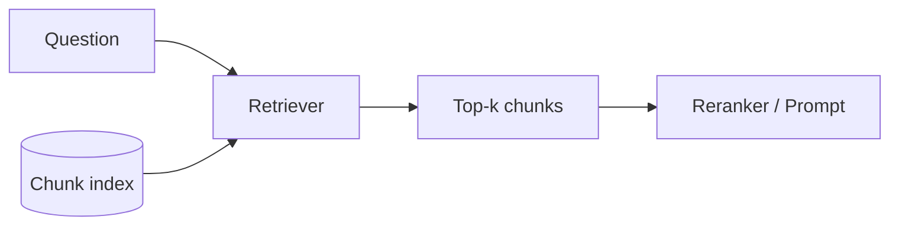
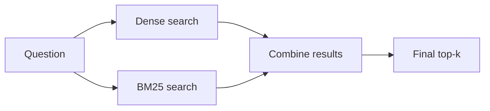

# 07 - Retrieval: Finding the Right Chunks

> If I had to pick one part of RAG that decides most of the quality, it would be retrieval. The LLM can only answer from what we hand it. If the right chunk never reaches the prompt, even the best model will guess or say "I don't know". This chapter covers how we search: dense search (by meaning), sparse search (by keywords), hybrid search (both together), and MMR (to avoid repeated results), plus filters and how many results to fetch.

**What you'll understand after this chapter**

- What retrieval does and what "top-k" means
- How dense retrieval works and where it fails
- How keyword search (BM25) works and where it wins
- Why hybrid search is often better than either one alone
- How MMR reduces duplicate results
- How to use metadata filters, score thresholds, and how to choose k
- How to measure retrieval quality

---

## 1. What Does Retrieval Do?

Retrieval takes a question and returns the **k most relevant chunks** from our knowledge base. Those chunks go into the prompt.



Two numbers matter right away:

- **k (top-k):** how many chunks we return
- **Score:** how relevant the retriever thinks each chunk is

> **The rule I keep in mind:** the LLM can't use a chunk it never sees. So if the answer exists in the documents but the retriever misses it, the whole system fails, and no prompt tuning can fix that.

---

## 2. Dense Retrieval (Search by Meaning)

This is what we have built so far. Embed the question, then find the chunk vectors closest to it.

```python
def dense_search(query, k=5):
    q_vec = embed_model.encode([query], normalize_embeddings=True).astype("float32")
    scores, ids = index.search(q_vec, k)
    return [{"chunk": chunks[i], "score": float(s)} for i, s in zip(ids[0], scores[0])]
```

### Where dense retrieval is strong

- Different words, same meaning: "automobile" vs "car"
- Questions phrased in natural language
- Paraphrases and loose matches

### Where it is weak

- **Exact terms:** product codes, error codes, names, IDs ("Error E-4021", "SKU-88213")
- **Rare words** the model hasn't seen much
- **Numbers and dates**
- **Specific phrases** that must match exactly

This weakness is the main reason we also look at keyword search.

---

## 3. Sparse Retrieval (Search by Keywords): BM25

Before embeddings, search engines used **keyword matching**. The most popular method is **BM25**, and it is still used everywhere because it works very well.

### The idea in simple words

BM25 scores a chunk higher when:

1. **The query words appear in it** (and more often is better, but with diminishing returns)
2. **The query words are rare overall.** A rare word like "E-4021" says a lot. A common word like "the" says nothing.
3. **The chunk is not very long.** A word in a short chunk counts for more than the same word in a huge chunk.

Those three ideas map to the classic terms: **term frequency**, **inverse document frequency (IDF)**, and **length normalization**.

### BM25 in code

```python
from rank_bm25 import BM25Okapi

texts = [c["text"] for c in chunks]
tokenized_corpus = [t.lower().split() for t in texts]
bm25 = BM25Okapi(tokenized_corpus)

def sparse_search(query, k=5):
    scores = bm25.get_scores(query.lower().split())
    top_ids = scores.argsort()[::-1][:k]
    return [{"chunk": chunks[i], "score": float(scores[i])} for i in top_ids]
```

The simple `.split()` tokenizer is just for learning. Real systems remove punctuation, and sometimes use stemming (so "refunds" and "refund" match). For production, search engines like Elasticsearch, OpenSearch, or databases with built-in BM25 are used.

### Where sparse retrieval is strong

- Exact words, names, codes, and IDs
- Rare technical terms
- Queries where the user uses the same words as the document

### Where it is weak

- Synonyms and paraphrases: "automobile" won't match "car"
- Questions phrased very differently from the text

### Dense vs sparse at a glance

| | **Dense (embeddings)** | **Sparse (BM25)** |
|---|---|---|
| Matches by | Meaning | Exact words |
| Synonyms | Yes | No |
| Exact codes and names | Often misses | Strong |
| Needs a model | Yes | No |
| Speed and cost | Needs embedding and vector index | Very cheap |
| Explainable | Hard | Easy (you can see which words matched) |

They are strong where the other is weak, which leads to the next idea.

---

## 4. Hybrid Search (Both Together)

**Hybrid search** runs dense and sparse retrieval and then **combines the results**.



An example of why this helps:

- Question: *"How do I fix Error E-4021?"*
  - **BM25** finds the chunk that contains "E-4021" exactly.
  - **Dense** may return general error-handling chunks.
- Question: *"What do I do if I can't log in?"*
  - **Dense** finds the "reset your password" chunk.
  - **BM25** may find nothing useful, since the words differ.

With hybrid search, both questions work.

### How do we combine two result lists?

The two methods give scores on **different scales** (a cosine score like 0.78 and a BM25 score like 12.4), so we can't just add them. Two common ways:

**Option 1: Reciprocal Rank Fusion (RRF)**
Ignore the scores and use only the **ranks**. A chunk ranked high in either list gets a good combined score.

```
RRF score = sum over lists of  1 / (k + rank)        (k is often about 60)
```

```python
def reciprocal_rank_fusion(result_lists, k=60):
    scores = {}
    for results in result_lists:
        for rank, item in enumerate(results, start=1):
            chunk_id = item["chunk"]["id"]
            scores[chunk_id] = scores.get(chunk_id, 0) + 1 / (k + rank)

    fused = sorted(scores.items(), key=lambda x: x[1], reverse=True)
    return fused    # list of (chunk_id, fused_score)
```

**Option 2: Weighted score**
Normalize both score sets (for example to a 0 to 1 range), then combine: `final = alpha * dense + (1 - alpha) * sparse`. You tune `alpha` on your data.

RRF is popular because it needs no score normalization and works well without much tuning. Weighted scores give you more control but need more care.

### Hybrid search end to end

```python
def hybrid_search(query, k=5, fetch=20):
    dense_results  = dense_search(query, k=fetch)
    sparse_results = sparse_search(query, k=fetch)

    fused = reciprocal_rank_fusion([dense_results, sparse_results])
    top_ids = [chunk_id for chunk_id, _ in fused[:k]]
    return [chunks_by_id[i] for i in top_ids]
```

Note the pattern: **fetch more candidates from each method (like 20), then fuse and keep the best k.** (This assumes each chunk has a unique `id`.)

Many tools support hybrid search built in: Elasticsearch, OpenSearch, Weaviate, Qdrant, and others, plus helper classes in LangChain and LlamaIndex. Check your tool's docs before building it yourself.

> Hybrid search is usually a safe improvement over dense-only search, especially when documents contain names, codes, or technical terms. But **measure it** on your own questions, because it isn't guaranteed to help every dataset.

---

## 5. MMR: Avoiding Repeated Results

Sometimes the top 5 results are all nearly the same text. This happens a lot with overlapping chunks or documents that repeat information. Five copies of the same fact waste space in the prompt and hide other useful information.

**MMR (Maximal Marginal Relevance)** picks results that are **relevant to the query but different from each other**.

### The idea

Pick chunks one at a time. For each candidate, score it as:

```
MMR score = lambda x (similarity to the query)  -  (1 - lambda) x (similarity to chunks already chosen)
```

- **lambda close to 1:** only care about relevance (like normal search)
- **lambda close to 0:** only care about diversity
- **lambda around 0.5:** a balance (a common starting point)

### MMR in code

```python
import numpy as np

def mmr(query_vec, candidate_vecs, k=4, lambda_mult=0.5):
    """query_vec: (d,), candidate_vecs: (n, d). Vectors should be normalized."""
    query_sims = candidate_vecs @ query_vec          # relevance of each candidate
    selected, remaining = [], list(range(len(candidate_vecs)))

    while remaining and len(selected) < k:
        best_id, best_score = None, -np.inf
        for i in remaining:
            if selected:
                redundancy = max(candidate_vecs[i] @ candidate_vecs[j] for j in selected)
            else:
                redundancy = 0
            score = lambda_mult * query_sims[i] - (1 - lambda_mult) * redundancy
            if score > best_score:
                best_id, best_score = i, score
        selected.append(best_id)
        remaining.remove(best_id)
    return selected
```

Typical use: fetch 20 candidates by similarity, then use MMR to pick the final 4 to 5.

### In LangChain

```python
retriever = vectorstore.as_retriever(
    search_type="mmr",
    search_kwargs={"k": 4, "fetch_k": 20, "lambda_mult": 0.5},
)
```

**Use MMR when:** your results are repetitive, or questions need information from several different parts of the documents.
**Skip it when:** you need the single most relevant passage and duplicates aren't a problem.

---

## 6. Metadata Filtering

Often we should search only a **part** of the data: one document, one department, one year, or only what the user is allowed to see. We saved metadata during ingestion, and now we use it.

```python
# Chroma
results = collection.query(
    query_embeddings=[query_vec.tolist()],
    n_results=5,
    where={"$and": [{"source": "hr_handbook.pdf"}, {"year": {"$gte": 2024}}]},
)
```

Common uses:

| Filter | Example |
|---|---|
| **By document** | "Search only in this PDF" |
| **By date or version** | Ignore outdated policies |
| **By type** | Only tables, or only FAQs |
| **By permission** | Only chunks the user's role may read |
| **By language or category** | Only French documents, only the "billing" topic |

**Self-querying (a nice idea):** let the LLM turn the user's question into a filter. For example, "What did the 2024 report say about revenue?" becomes `query="revenue"` with `filter: year = 2024`. This needs careful testing but can be powerful.

Permission filters need extra care. Always apply them **inside the search**, not after the LLM has seen the data.

(The pre-filter vs post-filter difference is explained in [06 - Vector Databases](./06-vector-databases.md).)

---

## 7. Choosing k and Using a Score Threshold

### How many chunks to retrieve?

| If k is too small | If k is too large |
|---|---|
| The right chunk may be left out | More noise, higher cost, slower answers |
| Answers that need several chunks fail | The model can get distracted or miss details |

There is no perfect number. The common pattern is:

1. **Retrieve a wider set** (for example 20) with the fast search.
2. **Narrow it down** with a reranker (next chapter) to the best 3 to 5.
3. Send only those to the LLM.

Without a reranker, a k of roughly 3 to 6 is a common starting point. Then test.

### Score threshold

A retriever always returns k results, even if none of them are relevant. If you ask a question that isn't covered in your documents, you still get the "closest" chunks, which are junk.

A **score threshold** drops results below a certain similarity:

```python
def retrieve_with_threshold(query, k=5, min_score=0.35):
    results = dense_search(query, k=k)
    return [r for r in results if r["score"] >= min_score]
```

If the list ends up empty, the system can answer "I couldn't find this in the documents" instead of making something up.

Be careful with the number: score values depend on the model, so **pick the threshold by looking at real examples** of relevant and irrelevant matches from your own data. Don't copy a number from a tutorial.

---

## 8. Other Retrieval Ideas (Short Overview)

- **Retrieve neighbors:** when a chunk matches, also fetch the chunks right before and after it, using `chunk_index`.
- **Parent-child retrieval:** search small chunks, return the larger parent (from [04 - Chunking](./04-chunking.md)).
- **Multi-query retrieval:** rewrite the question in several ways and merge the results (in [08 - Query Transformation](./08-query-transformation.md)).
- **Routing:** send the question to the right data source (for example, HR documents vs technical docs).
- **Multi-vector retrieval:** store several vectors per document, such as a summary vector and a content vector.
- **Learned sparse methods (like SPLADE):** sparse vectors that are learned by a model, giving some of the meaning-awareness of dense vectors with the exact matching of sparse ones.

---

## 9. Measuring Retrieval Quality

To improve retrieval, we need to measure it. Create a test set where each question has a known correct chunk or passage, then calculate:

| Metric | What it tells you |
|---|---|
| **Hit rate / Recall@k** | Was the correct chunk anywhere in the top k? |
| **MRR (Mean Reciprocal Rank)** | How high did the first correct chunk rank? (1st place = 1, 2nd = 0.5, 3rd = 0.33, ...) |
| **Precision@k** | What fraction of the returned k chunks were actually relevant? |
| **nDCG** | Ranking quality when relevance has degrees, not just yes or no |

```python
def evaluate_retrieval(eval_set, search_fn, k=5):
    """eval_set: [{"question": "...", "answer_snippet": "14 days"}, ...]"""
    hits, rr_total = 0, 0
    for item in eval_set:
        results = search_fn(item["question"], k)
        rank = None
        for i, r in enumerate(results, start=1):
            if item["answer_snippet"].lower() in r["chunk"]["text"].lower():
                rank = i
                break
        if rank:
            hits += 1
            rr_total += 1 / rank
    n = len(eval_set)
    return {"recall@k": hits / n, "mrr": rr_total / n}

for name, fn in [("dense", dense_search), ("sparse", sparse_search), ("hybrid", hybrid_search)]:
    print(name, evaluate_retrieval(eval_set, fn))
```

Run this for dense, sparse, and hybrid on the same questions, and put the results in a table. It is one of the best experiments for your portfolio:

| Method | Recall@5 | MRR |
|---|---|---|
| Dense only | (your result) | (your result) |
| BM25 only | (your result) | (your result) |
| Hybrid (RRF) | (your result) | (your result) |
| Dense + MMR | (your result) | (your result) |

(More about evaluation, including answer quality, is in [13 - Evaluation](./13-evaluation.md).)

---

## 10. Why Retrieval Fails: A Debugging Checklist

When the system gives a wrong answer, I first look at what was retrieved.

| Symptom | Likely cause | Things to try |
|---|---|---|
| Correct chunk not in the top k | Bad chunking, weak embedding model, or vague query | Better chunks, hybrid search, query rewriting, higher k with reranking |
| Exact code or name not found | Dense-only search | Add BM25 (hybrid) |
| Same information repeated 5 times | Overlapping chunks, duplicates | MMR, deduplication, less overlap |
| Answer needs two separate passages | k too small, or multi-part question | Larger k, multi-query, break the question into parts |
| Irrelevant chunks for out-of-scope questions | No threshold | Score threshold and an "I don't know" rule |
| Right chunk found but cut off | Chunk boundary problem | Retrieve neighbors, parent-child |
| Outdated answer | Old documents still indexed | Metadata filter by date or version, remove old files |
| Wrong department's data shown | Missing permission filter | Apply metadata filters inside the search |

---

## 11. Common Mistakes

- **Dense-only search on data full of codes and names.**
- **Combining raw scores** from different methods without normalizing them. Use RRF or normalize first.
- **Always returning k results**, even for questions the documents don't cover.
- **Copying a threshold or k** from a tutorial instead of testing on your own data.
- **Very large k** with no reranking, flooding the prompt with noise.
- **Ignoring duplicates** from overlapping chunks.
- **Applying permission filters after retrieval**, or after the LLM has seen the data.
- **Never measuring**, and tuning by feel.

---

## 12. Key Takeaways

1. **Retrieval quality decides answer quality.** The LLM can't use a chunk it never receives.
2. **Dense retrieval** finds by meaning. **BM25** finds by exact words. Each is strong where the other is weak.
3. **Hybrid search** combines them, and **RRF** is an easy way to merge two ranked lists without worrying about score scales.
4. **MMR** keeps results relevant but varied, so you don't send duplicates.
5. Use **metadata filters** for scope, freshness, and permissions, and apply them inside the search.
6. Fetch a wider set first, then narrow it (reranking comes next). Use a **score threshold** so out-of-scope questions get an honest "I don't know".
7. **Measure** with recall@k and MRR on your own test questions before changing things.

---

## 13. Quick Self-Check

1. Give one question where BM25 would beat dense search, and one where dense would beat BM25.
2. Why can't we just add dense and BM25 scores together? What can we do instead?
3. What problem does MMR solve, and what does the lambda value control?
4. Why is a score threshold useful, and why shouldn't you copy one from a tutorial?
5. If the right chunk isn't in the top 5, what are three things you could try?

---


