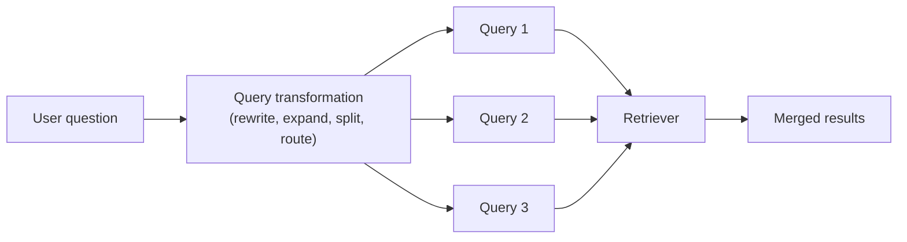
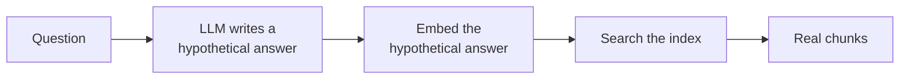
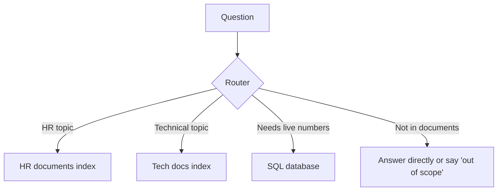

# 08 - Query Transformation: Improving the Question Before Searching

> Up to now we improved the documents side of RAG: better parsing, chunking, embeddings, and indexes. But the retriever also depends on the other side, the **question**. Real users write short, vague, messy questions. "What about the cost?" or "refund??" is not a good search query. This chapter is about rewriting or expanding the question so the retriever has a better chance of finding the right chunks.

**What you'll understand after this chapter**

- Why user questions are often bad search queries
- Query rewriting and conversational (follow-up) rewriting
- Multi-query and RAG-Fusion
- HyDE (searching with a fake answer)
- Step-back prompting
- Breaking complex questions into sub-questions
- Routing questions to the right data source
- When these tricks help, and when they only add cost

---

## 1. Why Do We Need This?

A user's question is written for a human. A search index needs something different. Here are the common problems:

| Problem | Example question | Why search struggles |
|---|---|---|
| **Too short or vague** | "refund??" | Not enough meaning to match |
| **Follow-up without context** | "And what about premium?" | "Premium" what? The question depends on the chat history |
| **Different words than the document** | "Can I get my money back?" vs the document's "reimbursement policy" | Wording gap |
| **Question vs answer style** | The question asks, the document states | Questions and statements sit differently in embedding space |
| **Several questions in one** | "Compare the leave policy and the refund policy" | One search can't fetch both topics well |
| **Too specific or too broad** | A very narrow question about one parameter, or a very broad one | Needs general background, or the opposite |
| **Wrong place to search** | HR question, but the index holds HR, legal, and tech docs | Noise from other sources |

Query transformation means **using an LLM (or simple rules) to turn the user's question into one or more better queries** before retrieval.



In the code below, `llm(prompt)` stands for any function that sends a prompt to your language model and returns its text answer.

---

## 2. Query Rewriting

**Idea:** ask the LLM to rewrite the question into a clearer, more complete, search-friendly version.

```python
def rewrite_query(question):
    prompt = f"""Rewrite the user's question so it is clear, specific, and suitable
for searching a document collection. Keep the original meaning. Do not answer it.
Return only the rewritten question.

Question: {question}
Rewritten question:"""
    return llm(prompt).strip()

# "refund??"  ->  "What is the refund policy and how long do customers have to request a refund?"
```

**Good:** cheap, fixes vague or messy questions.
**Risk:** the rewrite can drift from what the user meant, or add details that were never asked. Keep the instruction strict ("keep the original meaning").

### Conversational rewriting (for chatbots)

This one is very important for chat apps. A follow-up like "What about the cost?" means nothing alone. We rewrite it into a **standalone question** using the chat history.

```python
def make_standalone(history, question):
    prompt = f"""Given the chat history and the latest question, rewrite the latest
question so it can be understood without the history. If it is already standalone,
return it unchanged. Return only the question.

Chat history:
{history}

Latest question: {question}
Standalone question:"""
    return llm(prompt).strip()

# History: "User asked about the Premium plan refund window."
# Question: "And what about the cost?"
# Result:  "What is the cost of the Premium plan?"
```

Without this step, retrieval for follow-up questions usually fails. (More on chat memory in [11 - Conversational RAG](./11-conversational-rag.md).)

---

## 3. Multi-Query

**Idea:** a single question can be worded in many ways, and one wording may miss the right chunk. So generate **several versions** of the question, search with each, and merge the results.

```python
def generate_queries(question, n=3):
    prompt = f"""Generate {n} different versions of the question below, to help find
relevant documents. Use different words and angles. Write one per line, with no numbering.

Question: {question}"""
    lines = llm(prompt).strip().split("\n")
    return [question] + [l.strip() for l in lines if l.strip()][:n]   # keep the original too

# "Can I get my money back?"  ->
#   "What is the refund policy?"
#   "How do I request reimbursement for a purchase?"
#   "Conditions for cancelling and getting a refund"
```

Then search with every query and merge:

```python
def multi_query_retrieve(question, k=5):
    queries = generate_queries(question)
    result_lists = [dense_search(q, k=10) for q in queries]
    fused = reciprocal_rank_fusion(result_lists)           # from chapter 07
    top_ids = [chunk_id for chunk_id, _ in fused[:k]]
    return [chunks_by_id[i] for i in top_ids]
```

Using **RRF to merge** the results is sometimes called **RAG-Fusion**.

**Good:** more robust to wording differences, catches chunks that one phrasing misses.
**Bad:** several searches and one extra LLM call, so slower and more costly. Can also bring in some off-topic results.
**Use when:** your questions are vague, or the documents use different vocabulary than your users.

---

## 4. HyDE (Hypothetical Document Embeddings)

This idea surprised me when I first read it.

**The problem:** a question and the passage that answers it often look quite different. The question is short and asks. The passage is long and states facts. Embeddings of the two may not be as close as we'd like.

**The trick:** ask the LLM to **write a fake answer** to the question, then **search using the fake answer** instead of the question. The fake answer looks like a real document passage, so it lands closer to the real passage in embedding space.



```python
def hyde_search(question, k=5):
    prompt = f"""Write a short passage (3 to 4 sentences) that could appear in a
document answering this question. It's fine if some details are guessed.

Question: {question}
Passage:"""
    fake_answer = llm(prompt).strip()

    vec = embed_model.encode([fake_answer], normalize_embeddings=True).astype("float32")
    scores, ids = index.search(vec, k)
    return [chunks[i] for i in ids[0]]
```

**Very important:** the fake answer is used **only for searching**. We never show it to the user or give it to the LLM as facts. The real answer is still generated from the **real retrieved chunks**.

**Good:** can help when questions are short or the wording gap is large, and works without labeled data.
**Bad:** the LLM may guess wrong details and pull the search in the wrong direction, especially on topics it knows nothing about (like your private documents). It adds an LLM call, so more delay and cost.
**Use when:** you have tested it and it improves your results. I'd treat it as an experiment, not a default.

A related idea is to **generate questions for each chunk at indexing time** (each chunk gets a few "questions this chunk answers"), and then match the user's question against those. This is the reverse direction and also helps with the question-vs-statement gap.

---

## 5. Step-Back Prompting

**Idea:** sometimes the question is **too specific**, and the useful information is in a more general section. So we ask the LLM to create a **broader "step-back" question**, and retrieve for **both** the original and the broader question.

```python
def step_back_question(question):
    prompt = f"""Write a more general question that covers the background knowledge
needed to answer the question below. Return only the question.

Question: {question}
General question:"""
    return llm(prompt).strip()

# "Why does my service return error 429 after 100 calls per minute?"
#   ->  "How does the API rate limiting work?"
```

```python
def step_back_retrieve(question, k=5):
    broad = step_back_question(question)
    results = dense_search(question, k=k) + dense_search(broad, k=k)
    # remove duplicates by chunk id, then keep the best
    ...
```

**Good:** brings in background context that the specific question alone wouldn't match.
**Bad:** can add less relevant general text. One more LLM call.
**Use when:** questions are very specific but the documents explain things at a general level first.

---

## 6. Query Decomposition (Breaking into Sub-Questions)

**Idea:** some questions are really several questions. One search can't find everything, so we **split** the question, search for each part, and combine the findings.

> "Compare the leave policy and the refund policy for premium customers."

This needs information from two different places. We can split it:

1. "What is the leave policy?"
2. "What is the refund policy for premium customers?"

```python
def decompose(question):
    prompt = f"""If the question below contains several parts, split it into
simple, independent sub-questions. One per line. If it is already simple, return it unchanged.

Question: {question}
Sub-questions:"""
    return [l.strip() for l in llm(prompt).split("\n") if l.strip()]

def answer_complex(question):
    sub_questions = decompose(question)
    context = []
    for sq in sub_questions:
        context.extend(hybrid_search(sq, k=3))
    return llm(build_prompt(question, context))
```

For harder cases, sub-questions can depend on each other (the answer to the first is needed to ask the second), such as "Who founded the company that makes product X?". That is **multi-step retrieval**, and it leads into agentic RAG in [12 - Advanced RAG](./12-advanced-rag.md).

**Good:** handles comparison and multi-part questions, which plain retrieval handles poorly.
**Bad:** more calls, more delay, and the split can be wrong.
**Use when:** you see users asking multi-part or comparison questions.

---

## 7. Routing: Choosing Where to Search

**Idea:** if you have several data sources (HR docs, technical docs, a product database, the web), searching all of them for everything adds noise. A **router** decides **which source (or tool) to use** for each question.



### LLM-based router

```python
SOURCES = {
    "hr": "Leave, salary, benefits, workplace policies",
    "tech": "Product setup, errors, API usage",
    "billing": "Plans, prices, invoices, refunds",
}

def route(question):
    options = "\n".join(f"- {name}: {desc}" for name, desc in SOURCES.items())
    prompt = f"""Choose the best source for the question. Reply with only the source name,
or "none" if no source fits.

Sources:
{options}

Question: {question}
Source:"""
    choice = llm(prompt).strip().lower()
    return choice if choice in SOURCES else None
```

### Embedding-based router (no LLM call)

Describe each source with a few example questions, embed them, and send the user's question to the source with the closest examples. It is faster and cheaper, but less flexible.

### Routing can also choose the method

The router can pick *how* to answer: vector search, keyword search, a SQL query, a calculator, or a web search. This is the start of **agent** behavior, covered later.

**Good:** less noise, can combine very different sources.
**Bad:** a wrong route means the right data is never searched, so test it carefully and have a fallback (for example, search all sources if the router is unsure).

---

## 8. Turning Questions into Filters

Another useful transformation is extracting **filters** from the question (also called self-querying, mentioned in [07 - Retrieval](./07-retrieval.md)):

> "What did the 2024 annual report say about revenue?"
> becomes `query = "revenue"` and `filter = {year: 2024, doc_type: "annual report"}`

```python
import json

def extract_filters(question):
    prompt = f"""Extract search filters from the question. Return JSON with keys
"query" (the search text), and optionally "year" (integer) and "doc_type" (string).
Return only JSON.

Question: {question}"""
    try:
        return json.loads(llm(prompt))
    except json.JSONDecodeError:
        return {"query": question}          # safe fallback
```

Notice the fallback. LLM output is not always valid JSON, so always handle the failure.

---

## 9. Putting It Together

A simple query pipeline might look like this:

```python
def smart_retrieve(question, history=None, k=5):
    # 1. Make follow-up questions standalone
    if history:
        question = make_standalone(history, question)

    # 2. Decide where to search
    source = route(question)

    # 3. Expand into several queries
    queries = generate_queries(question, n=2)

    # 4. Search with each query, then merge
    result_lists = [hybrid_search(q, k=10, source=source) for q in queries]
    fused = reciprocal_rank_fusion(result_lists)

    top_ids = [chunk_id for chunk_id, _ in fused[:k]]
    return [chunks_by_id[i] for i in top_ids]
```

(`hybrid_search` here is assumed to accept a `source` filter. Adjust it to your own code.)

But this is a lot of LLM calls before the real answer even starts. Which brings up the main point of the chapter.

---

## 10. The Cost: Every Trick Adds Delay and Money

| Technique | Extra LLM calls | Extra searches | Main benefit |
|---|---|---|---|
| Rewriting | 1 | 0 | Cleaner query |
| Conversational rewrite | 1 | 0 | Follow-up questions work |
| Multi-query | 1 | n | Robust to wording |
| HyDE | 1 | 0 or 1 | Bridges question/answer gap |
| Step-back | 1 | 1 | Adds background context |
| Decomposition | 1 | one per sub-question | Multi-part questions |
| Routing | 0 or 1 | 0 | Less noise from wrong sources |

Because each call adds waiting time, I follow these habits:

- **Don't add all techniques by default.** Add one when you see the problem it fixes.
- **Use a small, fast model** for transformation steps. They are simple tasks.
- **Skip transformation for easy questions.** A simple rule or classifier can decide if it's needed.
- **Cache** transformed queries for repeated questions.
- **Measure** each one. If a technique doesn't improve your metrics, remove it.

---

## 11. Which Technique for Which Problem?

| Your problem | Try first |
|---|---|
| Follow-up questions fail in chat | Conversational rewriting |
| Short, vague questions | Query rewriting |
| Right chunk exists but wording differs | Multi-query (with RRF), or hybrid search |
| Question and passages look very different | HyDE (test carefully) |
| Very specific questions needing background | Step-back |
| Comparison or multi-part questions | Decomposition |
| Several data sources | Routing |
| Questions mention dates, authors, or categories | Filter extraction |

---

## 12. Common Mistakes

- **Adding every technique at once** with no measurements.
- **Letting the rewrite change the meaning** of the question. Instruct the LLM to keep the intent and not answer.
- **Using the HyDE fake answer as a fact** in the final answer. It is only for searching.
- **Skipping the standalone rewrite** in a chatbot, then wondering why follow-ups fail.
- **No fallback for routing or JSON parsing** when the LLM output is unexpected.
- **Using a big, slow model** for simple rewriting steps.
- **Forgetting about delay and cost**, so the chatbot feels slow.
- **Testing only on easy questions**, so these techniques seem useless. Test on the hard ones.

---

## 13. Key Takeaways

1. User questions are often short, vague, dependent on chat history, or worded differently from the documents.
2. **Query transformation** improves the question before retrieval, using an LLM or simple rules.
3. **Rewriting** cleans the question. **Conversational rewriting** makes follow-ups standalone, which is essential for chatbots.
4. **Multi-query** (with RRF) and **HyDE** attack the wording gap. **Step-back** adds background. **Decomposition** handles multi-part questions. **Routing** picks the right source.
5. HyDE's fake answer is **only a search tool**, never a source of facts.
6. Every technique adds **latency and cost**. Add them one at a time and **measure** the gain.

---

## 15. Quick Self-Check

1. Why does a follow-up question like "What about the cost?" fail in retrieval, and how do we fix it?
2. How does multi-query help, and how do we merge its results?
3. Explain HyDE in two sentences. Why must we never show the hypothetical answer as a fact?
4. When would step-back prompting help? When would decomposition help?
5. Why shouldn't you add all of these techniques to every project?

---


