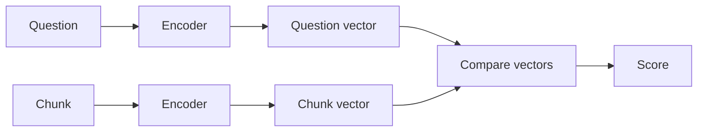
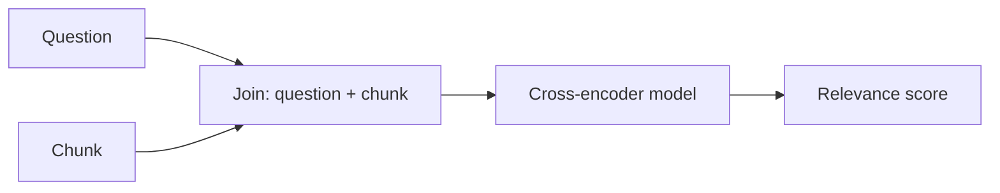
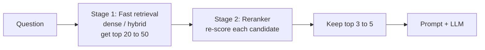

# 09 - Reranking: Putting the Best Chunks First

> The first search in RAG is fast, but it is also a bit rough. It is good at finding a pool of *possibly* relevant chunks, but it often puts the best one in 3rd or 7th place instead of 1st. Reranking is a second, more careful look at that pool. In my experience this is one of the simplest changes that gives a clear quality boost, so this chapter explains how it works, which models to use, and what it costs.

**What you'll understand after this chapter**

- Why the first search isn't enough
- The difference between a bi-encoder and a cross-encoder
- The "retrieve many, rerank to few" pattern
- How to use open-source and API rerankers
- LLM-based reranking and ColBERT (short overview)
- The cost in speed, and how to measure if reranking is worth it

---

## 1. The Problem: Fast Search Is Rough

Think about how embeddings search works. The question and every chunk are turned into vectors **separately**, and then we compare the vectors. The model never looks at the question and a chunk **together**.

That is why it's fast, but it also loses detail. The vector of a chunk is a squeezed summary made *before* the question was even known.

Typical symptoms:

- The right chunk is in the top 10, but not in the top 3
- A chunk about a similar topic outranks the chunk that truly answers the question
- Increasing k fixes recall, but floods the prompt with noise

Reranking fixes this by re-scoring the top candidates with a smarter model.

---

## 2. Bi-Encoder vs Cross-Encoder

This is the key idea of the chapter.

### Bi-encoder (what we use for retrieval)

The question and each chunk are encoded **separately**. We compare the two vectors.



- Chunk vectors can be **computed once, in advance**, and stored
- Search is very fast, even over millions of chunks
- Less accurate, since the question and chunk never "meet" inside the model

### Cross-encoder (what we use for reranking)

The question and one chunk are fed **together** into the model, which reads both at the same time and outputs one relevance score.



- The model can compare **every word of the question with every word of the chunk**
- Much more accurate
- **Slow**: nothing can be precomputed, because the score depends on the question. It must run once per (question, chunk) pair

### An analogy

- **Bi-encoder:** a recruiter who sorts a pile of resumes by quickly reading only each one's summary line, without knowing the specific job. Fast, rough.
- **Cross-encoder:** the same recruiter reading each shortlisted resume carefully **against the actual job description**. Slow, but a much better judgment.

You wouldn't carefully read 10,000 resumes. You'd skim to a shortlist, then read the shortlist carefully. That is exactly how reranking works.

### Side by side

| | **Bi-encoder** | **Cross-encoder** |
|---|---|---|
| Input | Question and chunk separately | Question and chunk together |
| Precompute chunk side? | Yes | No |
| Accuracy | Good | Better |
| Speed | Very fast | Slow (one run per pair) |
| Use for | Searching the whole collection | Re-scoring a small shortlist |

---

## 3. The Two-Stage Pattern: Retrieve, Then Rerank



1. **Stage 1 (recall-focused):** cast a wide net. Retrieve a larger set, like 20 to 50 chunks. The goal is that the right chunk is *somewhere* in the set.
2. **Stage 2 (precision-focused):** the reranker scores every candidate carefully and sorts them. Keep only the top 3 to 5.

The benefits:

- Stage 1 improves **recall** (don't miss it)
- Stage 2 improves **precision** (put it first)
- The LLM gets fewer, better chunks, so **less noise and lower cost**

---

## 4. Reranking in Code

### 4.1 Open-source cross-encoder (runs locally)

```python
from sentence_transformers import CrossEncoder

reranker = CrossEncoder("cross-encoder/ms-marco-MiniLM-L-6-v2")

def rerank(question, candidates, top_n=4):
    pairs = [(question, c["text"]) for c in candidates]
    scores = reranker.predict(pairs)

    ranked = sorted(zip(candidates, scores), key=lambda x: x[1], reverse=True)
    return [{**c, "rerank_score": float(s)} for c, s in ranked[:top_n]]
```

### 4.2 Using it in the pipeline

```python
def retrieve_and_rerank(question, fetch=30, top_n=4):
    candidates = hybrid_search(question, k=fetch)      # stage 1: wide net
    return rerank(question, candidates, top_n=top_n)   # stage 2: careful sort
```

### 4.3 A hosted reranking API (example: Cohere)

```python
import cohere

co = cohere.Client("YOUR_API_KEY")

response = co.rerank(
    model="rerank-english-v3.0",         # check the docs for current model names
    query=question,
    documents=[c["text"] for c in candidates],
    top_n=4,
)

for r in response.results:
    print(r.relevance_score, candidates[r.index]["text"][:80])
```

Model names and client versions change over time, so always check the provider's documentation. Other hosted options include Jina, Voyage, and similar services.

---

## 5. Choosing a Reranker

| Option | Type | Notes |
|---|---|---|
| **MS MARCO MiniLM cross-encoders** (`cross-encoder/ms-marco-...`) | Open-source, small | Easy to start with, runs on CPU, good baseline |
| **BGE rerankers** (BAAI `bge-reranker-...` family) | Open-source, base and large sizes, some multilingual | Strong quality, larger ones are slower |
| **Cohere Rerank** | Hosted API | Easy, multilingual options, pay per use |
| **Jina, Voyage rerankers** | Hosted API / some open | Other good API options |
| **FlashRank and similar lightweight rerankers** | Open-source, very small | Very fast on CPU, good when speed matters |
| **LLM-based reranking** | Uses a general LLM | Flexible, but slower and more expensive (see below) |

How I'd pick:

1. Start with a **small open-source cross-encoder** for a baseline.
2. Try one **stronger model** (a larger BGE reranker or a hosted API).
3. Compare on **your own test questions**: quality, speed, cost, language, and privacy (will the data leave your machine?).

As with embedding models, new rerankers come out often. Check the current leaderboards and model cards instead of trusting a fixed list.

---

## 6. Other Reranking Approaches (Short Overview)

### 6.1 LLM-based reranking

Ask a normal LLM to judge relevance.

**Pointwise:** score each chunk separately.

```python
def llm_relevance(question, chunk_text):
    prompt = f"""Rate how useful the passage is for answering the question,
from 0 (useless) to 10 (directly answers it). Reply with only the number.

Question: {question}
Passage: {chunk_text}
Score:"""
    try:
        return float(llm(prompt).strip())
    except ValueError:
        return 0.0
```

**Listwise:** show the LLM all candidates at once and ask it to return them in order of relevance. This needs fewer calls, but long lists can exceed the context window, and the model may skip or repeat items.

**Good:** very flexible, can follow special instructions ("prefer newer documents"), no model training needed.
**Bad:** slower and more expensive than a cross-encoder, and results can vary between runs.

### 6.2 ColBERT and late interaction

ColBERT sits between a bi-encoder and a cross-encoder. It stores **one vector per token** of each chunk (not one per chunk), and at search time it compares the question's token vectors with the chunk's token vectors. This keeps more detail than a single vector while still allowing precomputation. It is more accurate than plain bi-encoders but needs more storage and special tooling. Good to know about, but not a beginner's first step.

### 6.3 Other signals

Reranking can also consider things beyond text similarity: document **date** (prefer newer), **source authority** (official policy over a chat message), or **user feedback**. These are often combined with the model score.

---

## 7. Speed and Cost: What Reranking Adds

A cross-encoder runs once per candidate. So the time grows with the number of candidates.

```
rerank time  ≈  number of candidates x time per pair
```

What affects it:

| Factor | Effect |
|---|---|
| **Number of candidates** | Reranking 50 takes about twice as long as 25 |
| **Chunk length** | Longer chunks need more computation |
| **Model size** | Larger models are slower and more accurate |
| **Hardware** | A GPU is much faster than a CPU for this |
| **Batching** | Scoring pairs in batches is more efficient |

I don't want to give exact numbers because they depend completely on your machine and model, so **measure it yourself:**

```python
import time

start = time.perf_counter()
reranked = rerank(question, candidates, top_n=4)
print(f"Reranking {len(candidates)} chunks took {time.perf_counter() - start:.2f}s")
```

Ways to keep reranking fast:

- Rerank **only 20 to 50** candidates, not hundreds
- Use a **smaller or lighter model** if speed matters
- Use a **GPU** for larger models
- Keep chunks within the model's **maximum input length** (many rerankers accept around 512 tokens of question plus chunk, and extra text is cut off, so check your model)
- Cache results for repeated questions

The saving on the other side: sending 4 good chunks to the LLM instead of 10 mixed ones **lowers LLM cost and time**, which often offsets part of the reranking cost.

---

## 8. Using Reranker Scores

Reranker scores are useful, but treat them carefully.

- A score is for **ordering** chunks within one query. Don't treat it as a probability or compare it across different models.
- Some models output a raw number (a logit) that can be negative. Some output 0 to 1. Look at the model's documentation.
- You *can* use a **threshold on the reranker score** to drop clearly irrelevant chunks, and this is often more reliable than a threshold on embedding similarity, because the reranker looks at the pair together. If **no chunk passes the threshold**, answer "I couldn't find this in the documents."

```python
def rerank_with_threshold(question, candidates, top_n=4, min_score=0.0):
    ranked = rerank(question, candidates, top_n=top_n)
    return [r for r in ranked if r["rerank_score"] >= min_score]
```

As always, choose the threshold by **looking at real relevant and irrelevant examples** from your data.

### Ordering inside the prompt

Research on long contexts (the "lost in the middle" findings) suggests models use information at the **start and end** of the prompt more reliably than information in the middle. So some people place the best chunks first (and sometimes also at the end), and the weaker ones in the middle. It's a small tweak, and worth testing, not guaranteed.

---

## 9. When Reranking Does NOT Help

Reranking only **reorders** what stage 1 found. It can't create results.

- If the right chunk is **not in the candidate set**, no reranker can bring it back. This is a **recall problem**, fixed with better chunking, hybrid search, query transformation, or a larger candidate set.
- If your set of candidates is already tiny (say 3 chunks), reranking has little to do.
- If latency is extremely tight, the extra step may not be worth it.
- If your questions are simple and your retrieval is already very accurate, the gain may be small.

A quick check to see which problem you have:

```python
def diagnose(eval_set, fetch=30, top_n=4):
    in_candidates, in_top = 0, 0
    for item in eval_set:
        cands = hybrid_search(item["question"], k=fetch)
        if any(item["answer_snippet"].lower() in c["text"].lower() for c in cands):
            in_candidates += 1
        top = rerank(item["question"], cands, top_n=top_n)
        if any(item["answer_snippet"].lower() in c["text"].lower() for c in top):
            in_top += 1
    n = len(eval_set)
    print(f"Right chunk in candidates: {in_candidates / n:.2f}")
    print(f"Right chunk in final top {top_n}: {in_top / n:.2f}")
```

Read the two numbers like this:

- **Candidates low** means a retrieval (recall) problem. Fix stage 1.
- **Candidates high but final top low** means a ranking problem. Reranking should help.

---

## 10. Common Mistakes

- **Reranking the whole collection** instead of a shortlist, which is far too slow.
- **Too few candidates** (like 5), so there is nothing worth reordering.
- **Too many candidates** (hundreds), making reranking slow and costly.
- **Expecting reranking to fix a recall problem.** It can't bring back a missing chunk.
- **Treating scores as probabilities**, or comparing scores across different models.
- **Ignoring the model's input limit**, so long chunks get cut off.
- **Not measuring the latency** added by the reranker.
- **Using an English-only reranker** on other languages.
- **Skipping evaluation** and assuming reranking always helps.

---

## 11. Key Takeaways

1. First-stage retrieval is **fast but rough**. It often finds the right chunk but ranks it too low.
2. A **bi-encoder** encodes question and chunk separately (fast, precomputable). A **cross-encoder** reads them together (accurate, slow).
3. The standard pattern: **retrieve many (20 to 50) with fast search, rerank to a few (3 to 5)**.
4. Rerankers include open-source cross-encoders (MiniLM, BGE), hosted APIs (Cohere and others), and LLM-based reranking.
5. Reranking **costs time** that grows with the number of candidates, but sending fewer, better chunks to the LLM saves some of it back.
6. Reranking **can't fix missing recall**. Check whether the right chunk is in your candidates first.
7. **Measure** recall, MRR, and latency with and without reranking.

---

## 12. Quick Self-Check

1. Why is a cross-encoder more accurate than a bi-encoder, and why can't we use it to search the whole collection?
2. Explain the "retrieve many, rerank to few" pattern in your own words.
3. If the correct chunk isn't in the top 30 from stage 1, can reranking help? Why or why not?
4. Name two ways to keep reranking fast.
5. How can you tell whether your system has a recall problem or a ranking problem?

---


