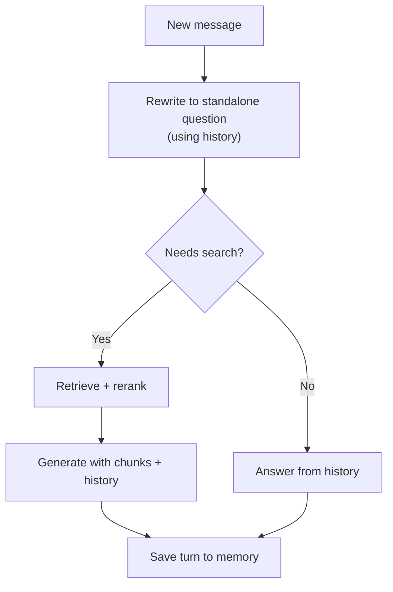

# 11 - Conversational RAG: Chat Memory and Follow-Up Questions

> So far, every question in this guide was a single, standalone question. But a chatbot is a conversation. People say things like "What about the premium plan?" or "Can you explain that more simply?" and expect the bot to remember what they were talking about. This chapter covers the few ideas that matter most for making RAG work in a chat: rewriting follow-up questions, keeping a short memory, and knowing when not to search.

**What you'll understand after this chapter**

- Why follow-up questions break normal RAG
- How to rewrite a follow-up into a standalone question
- How to keep chat history without overflowing the prompt
- When to search and when to skip searching
- How to handle sessions in a real app

---

## 1. The Problem: Follow-Up Questions

Look at this chat:

```
User: What is the refund window for the Premium plan?
Bot:  Premium plan purchases can be refunded within 14 days. [1]
User: And what about Basic?
```

The last question is "And what about Basic?" If we send exactly that to the retriever, it searches for "Basic" and finds random text. The retriever has no idea the user is asking about the **refund window**.

Common patterns that cause this:

| Pattern | Example |
|---|---|
| **Pronouns** | "How much does *it* cost?" |
| **Missing subject** | "And what about Basic?" |
| **References to the answer** | "Can you explain *that* more simply?" |
| **Short replies** | "Yes", "The second one" |

The fix is simple: before searching, turn the follow-up into a **complete question that makes sense on its own**.

---

## 2. Fix 1: Rewrite into a Standalone Question

Use the chat history to rewrite the latest message.

```python
def make_standalone(history_text, question):
    prompt = f"""Given the chat history and the latest user message, rewrite the
latest message as a complete, standalone question. Keep the original meaning.
If it is already standalone, return it unchanged. Do not answer it.
Return only the question.

Chat history:
{history_text}

Latest message: {question}
Standalone question:"""
    return llm(prompt).strip()
```

Result for our example:

```
"And what about Basic?"  ->  "What is the refund window for the Basic plan?"
```

Now the retriever has something real to search for.

**Important points:**

- Use the **rewritten question for retrieval**.
- It is fine to show the **original question and the chat history to the LLM** when generating the answer, so the reply sounds natural.
- Use a **small, fast model** for this step, since it's a simple task and it happens on every turn.
- Only the last few turns are needed for the rewrite. You don't have to send the whole conversation.

---

## 3. Fix 2: Keep a Short Memory

The LLM remembers nothing between calls. **We must send the history ourselves** every time. But the history can't grow forever, because of the context window, cost, and speed.

### Three simple memory strategies

| Strategy | How it works | Good | Bad |
|---|---|---|---|
| **Last N turns (buffer)** | Keep only the most recent N messages | Simple, predictable | Forgets older details |
| **Summary** | Replace old messages with a short summary | Keeps the gist of a long chat | Summaries can lose details or add mistakes |
| **Summary + last N turns** | Summary of old parts plus recent messages in full | Best balance, most common | Slightly more work |

For most chatbots, **summary + last few turns** is a good choice. For short chats, the last 4 to 6 turns alone are often enough.

### A small memory class

```python
class Conversation:
    def __init__(self, max_recent_turns=4):
        self.turns = []              # list of {"user": ..., "assistant": ...}
        self.summary = ""            # summary of older turns
        self.max_recent_turns = max_recent_turns

    def add_turn(self, user_msg, assistant_msg):
        self.turns.append({"user": user_msg, "assistant": assistant_msg})
        if len(self.turns) > self.max_recent_turns:
            self._compress()

    def _compress(self):
        oldest = self.turns.pop(0)
        prompt = f"""Update the conversation summary with the new exchange.
Keep important facts, names, and what the user is trying to do. Be brief.

Current summary: {self.summary or "(none)"}

New exchange:
User: {oldest['user']}
Assistant: {oldest['assistant']}

Updated summary:"""
        self.summary = llm(prompt).strip()

    def history_text(self):
        parts = []
        if self.summary:
            parts.append(f"Summary of earlier conversation: {self.summary}")
        for t in self.turns:
            parts.append(f"User: {t['user']}\nAssistant: {t['assistant']}")
        return "\n".join(parts)
```

### A useful tip: what to store in history

Store only the **user's question** and the **assistant's final answer text**. Don't store the retrieved chunks. Old chunks fill the prompt with text that may not be relevant to the new question. We **retrieve fresh chunks every turn**.

---

## 4. Fix 3: Decide Whether to Search

Not every message needs retrieval.

| Message | Needs search? |
|---|---|
| "What is the refund window?" | Yes |
| "Thanks!" | No |
| "Can you make that shorter?" | No (rewrite the previous answer) |
| "Hello" | No |
| "What did you just say about Basic?" | No (answer from the history) |
| "And the cancellation policy?" | Yes (new topic) |

Searching on every message wastes time and money, and can add irrelevant context to a simple reply. A cheap way to handle this is a small classifier:

```python
def needs_search(history_text, message):
    prompt = f"""Decide if the user's latest message needs a search of the document
collection, or can be answered from the chat history or is just small talk.

Chat history:
{history_text}

Latest message: {message}

Reply with only SEARCH or NO_SEARCH."""
    return llm(prompt).strip().upper().startswith("SEARCH")
```

**Be careful:** if the classifier is wrong, the bot may answer from memory when it should have searched, and can hallucinate. When unsure, **default to searching**. Many simple chatbots just search every time and skip this step, which is perfectly fine to start with.

---

## 5. Putting It Together

```python
def chat(conversation, question):
    history = conversation.history_text()

    # 1. Rewrite follow-ups
    standalone = make_standalone(history, question) if history else question

    # 2. Search (or skip)
    if not history or needs_search(history, question):
        chunks = retrieve_and_rerank(standalone)
        chunks = [c for c in chunks if c["rerank_score"] >= MIN_SCORE]
    else:
        chunks = []

    # 3. Generate. Give the model the history too, so replies feel natural.
    if chunks:
        answer = llm_chat(
            system=SYSTEM_PROMPT,
            user=f"Chat history:\n{history}\n\n" + build_user_prompt(question, chunks),
            temperature=0.1,
        )
    elif history:
        answer = llm_chat(
            system="Answer using only the chat history. If it isn't there, say you "
                   "need to search the documents.",
            user=f"Chat history:\n{history}\n\nUser: {question}",
            temperature=0.1,
        )
    else:
        answer = "I couldn't find this in the provided documents."

    conversation.add_turn(question, answer)
    return answer
```

The flow:



---

## 6. Handling Topic Changes

Sometimes the user changes topic: "Okay. Now, what is the leave policy?" The rewrite step should **not** pull old topic words into the new question. The instruction "if it is already standalone, return it unchanged" helps here. Test your rewriter with a few topic switches to make sure it doesn't mix topics.

---

## 7. Sessions in a Real App

In a real chat app, many users talk at the same time, so memory must be stored **per conversation**.

- Give every conversation a **session ID**.
- Store the history (and summary) in a **database or cache** like Redis, not in a global variable.
- Set a **limit** on stored history and an **expiry** for old sessions.
- Think about **privacy**: chat history can contain personal information, so decide how long to keep it and who can see it.
- Keep each user's **permissions** attached to the session, so retrieval filters still apply.

```python
sessions = {}    # simple example; use a database or Redis in real apps

def get_conversation(session_id):
    if session_id not in sessions:
        sessions[session_id] = Conversation()
    return sessions[session_id]
```

---

## 8. Common Mistakes

- **Sending the raw follow-up to the retriever**, so "And Basic?" finds nothing.
- **Sending the entire history** every time, so cost and delay grow with each turn.
- **Storing retrieved chunks in the history**, which fills the prompt with stale text.
- **Reusing old chunks** for a new question instead of retrieving again.
- **A rewriter that answers the question** or changes its meaning. Tell it clearly to only rewrite.
- **Skipping search by default** and letting the bot answer from memory when it needed documents.
- **One global memory shared by all users.**
- **Never testing** with follow-ups, pronouns, and topic switches.

---

## 9. Key Takeaways

1. Follow-up questions like "And what about Basic?" fail in retrieval because they don't make sense alone.
2. **Rewrite each follow-up into a standalone question** using recent history, and use that for searching.
3. The LLM has no memory, so **we send the history**. Keep it short: **summary of older turns + the last few turns**.
4. Store only the **questions and final answers** in history, and **retrieve fresh chunks each turn**.
5. Not every message needs a search. If unsure, **search**.
6. In a real app, store memory **per session**, and think about **privacy and permissions**.

---

## 10. Quick Self-Check

1. Why does "And what about Basic?" fail with normal RAG? How do we fix it?
2. Why don't we send the full chat history on every turn?
3. Why should we avoid saving retrieved chunks in the history?
4. Give one message that needs no search and one that does.
5. How should memory be stored in an app with many users?

---


