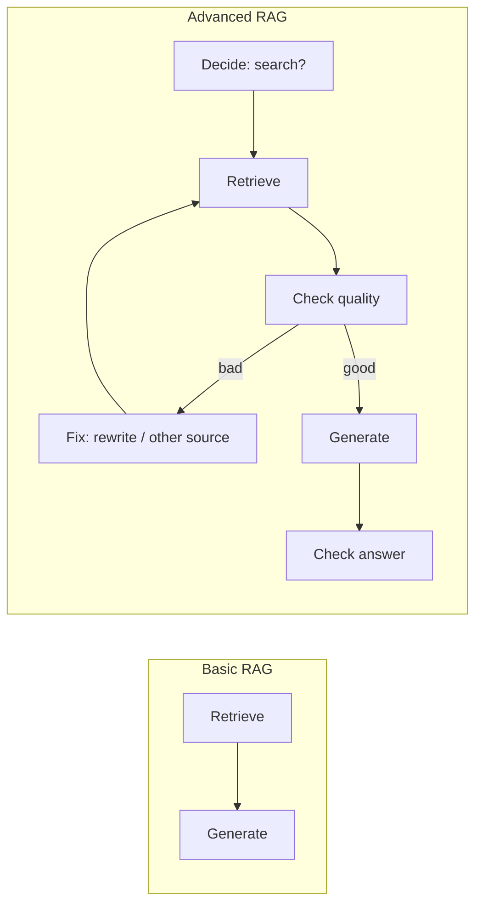
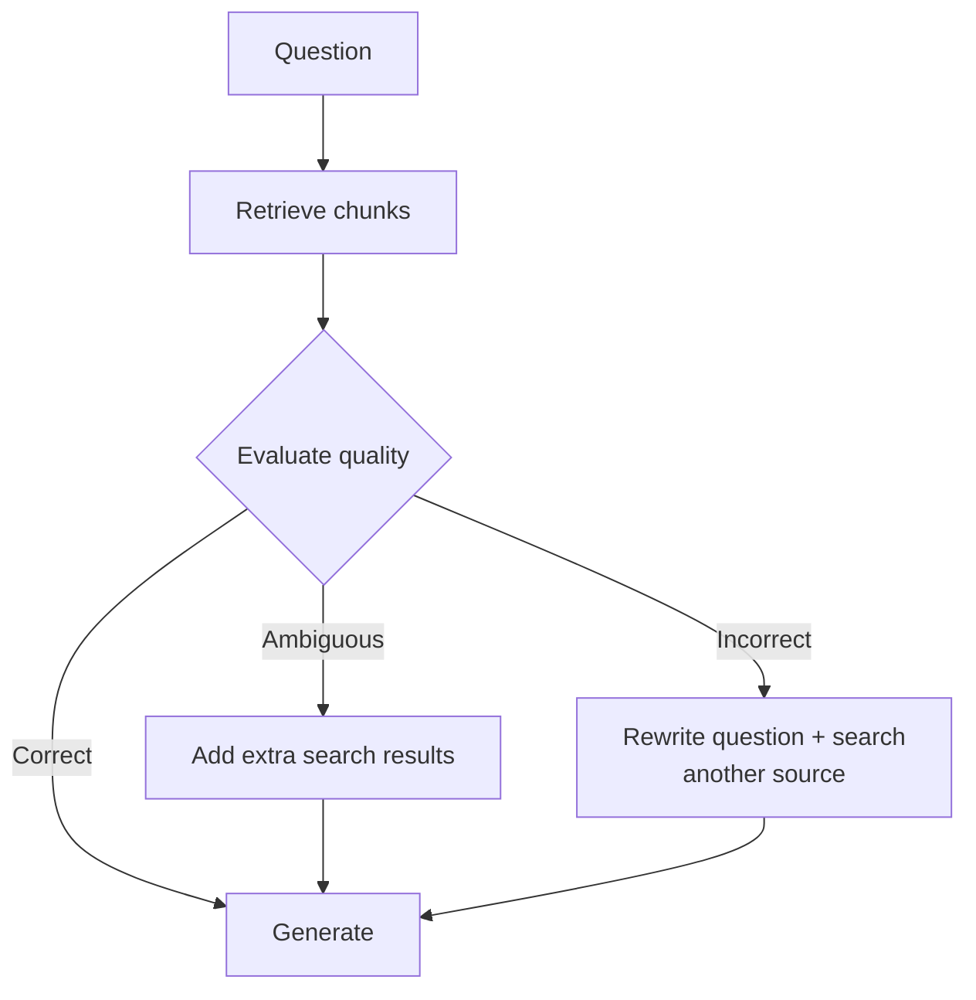
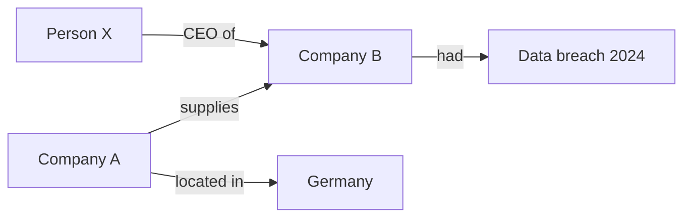
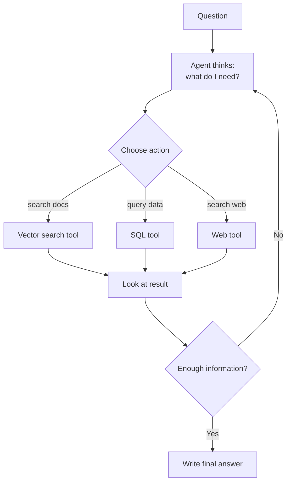
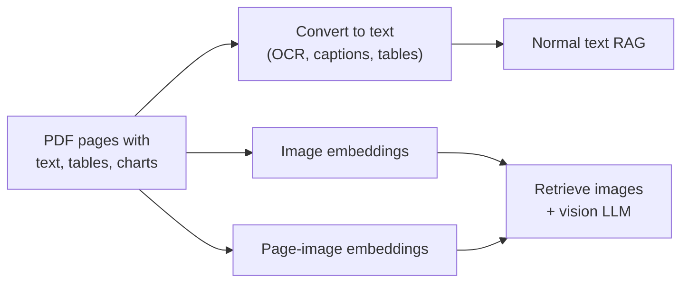

# 12 - Advanced RAG: Beyond the Basic Pipeline

> By now we have a solid RAG pipeline: good ingestion, chunking, hybrid search, reranking, and a careful prompt. For many projects, that is enough. But sometimes the basic pipeline hits a wall: the retrieved chunks are wrong and the bot doesn't notice, a question needs facts connected across many documents, or the answer lives in a chart. This chapter covers the five advanced ideas that matter most, in simple words: **Self-RAG, Corrective RAG, Graph RAG, Agentic RAG, and Multimodal RAG**.

**What you'll understand after this chapter**

- What problem each advanced technique solves
- How each one works, in simple terms
- Their costs and risks
- How to decide whether you need any of them

> **A rule I follow:** don't start here. Build the basic pipeline, measure it, find the specific failures, and only then add the technique that fixes them. Advanced does not mean better. It means more complex, slower, and more expensive.
---

## 1. The Big Idea: Add Judgment to the Pipeline

Basic RAG is a straight line: retrieve, then generate. It never asks "Did I find something good?" Most advanced techniques add **decisions and feedback** to that line.



---

## 2. Self-RAG

### The problem

Basic RAG retrieves on every question, even when it isn't needed, and it never checks whether the retrieved text was useful or whether the answer is really supported by it.

### The idea

**Self-RAG** (Asai et al., 2023) teaches the model to **reflect on itself**. It decides:

1. **Should I retrieve at all?**
2. **Is this retrieved chunk relevant?**
3. **Is my answer supported by the chunk?**
4. **Is my answer useful?**

In the original paper, a model is *trained* to produce special "reflection tokens" for these judgments. That needs a specially trained model, which most of us don't have.

### A practical version with plain prompts

You can copy the spirit of Self-RAG without training, by adding checks with a normal LLM:

```python
def grade_relevance(question, chunk_text):
    prompt = f"""Is the passage relevant for answering the question?
Reply with only YES or NO.

Question: {question}
Passage: {chunk_text}"""
    return llm(prompt).strip().upper().startswith("YES")

def self_check_answer(answer, context):
    prompt = f"""Is every claim in the answer supported by the context?
Reply with only YES or NO.

Context: {context}
Answer: {answer}"""
    return llm(prompt).strip().upper().startswith("YES")

def self_rag(question):
    chunks = retrieve_and_rerank(question)
    chunks = [c for c in chunks if grade_relevance(question, c["text"])]   # keep relevant ones

    if not chunks:
        return "I couldn't find this in the provided documents."

    answer = generate(question, chunks)
    context = "\n".join(c["text"] for c in chunks)

    if not self_check_answer(answer, context):
        return "I'm not confident the documents fully support an answer to this."
    return answer
```

**Good:** fewer wrong answers, filters out irrelevant chunks, admits uncertainty.
**Bad:** several extra LLM calls per question, so more delay and cost. The checks themselves can be wrong.
**Use when:** accuracy matters more than speed (legal, medical, finance, support for critical systems).

---

## 3. Corrective RAG (CRAG)

### The problem

When retrieval fails (the right information isn't in the retrieved chunks), basic RAG still generates an answer from bad chunks. That is how many hallucinations start.

### The idea

**Corrective RAG** (Yan et al., 2024) adds a **retrieval evaluator** that grades the retrieved chunks and then **takes a different action depending on the grade**:

| Grade | Action |
|---|---|
| **Correct** (chunks look good) | Use them (optionally trim to the relevant parts) |
| **Incorrect** (chunks look bad) | Throw them away and try something else, such as a web search or another data source |
| **Ambiguous** (unclear) | Combine the chunks with extra search results |



```python
def corrective_rag(question):
    chunks = retrieve_and_rerank(question)
    good = [c for c in chunks if grade_relevance(question, c["text"])]

    if len(good) >= 2:                         # correct: enough good evidence
        context = good
    elif len(good) == 1:                       # ambiguous: add more
        context = good + search_fallback(rewrite_query(question))
    else:                                      # incorrect: try another source
        context = search_fallback(rewrite_query(question))

    if not context:
        return "I couldn't find this in the available sources."
    return generate(question, context)
```

(`search_fallback` can be a web search, another document index, or a different retrieval method. If it is a web search, treat that content with extra care, since it is less trusted than your own documents.)

**Good:** recovers from bad retrieval instead of answering from bad evidence.
**Bad:** needs a good evaluator and a good fallback source. More calls and delay.
**Use when:** your documents don't cover every question and you have a second source to fall back on.

---

## 4. Graph RAG

### The problem

Normal RAG finds **individual chunks**. But some questions need the **big picture or connections across documents**:

- "What are the main themes across all these reports?" (needs a summary of everything)
- "Which suppliers are connected to the company that had the data breach?" (needs links between facts in different places)

Searching for a few similar chunks can't answer these well. The relevant information is spread out, and no single chunk contains the answer.

### The idea

**Graph RAG** first builds a **knowledge graph** from the documents: a map of **entities** (people, companies, products, places) and the **relationships** between them. Then retrieval can follow the connections.



How it is built (simplified):

1. Use an LLM to **extract entities and relationships** from each chunk.
2. Store them as a **graph**.
3. At query time, **find the relevant entities**, then **walk the graph** to collect connected facts (plus the original text chunks).
4. Give that connected information to the LLM.

Microsoft's GraphRAG approach goes further: it groups the graph into **communities** (clusters of related entities) and writes **summaries for each community**. Then "big picture" questions can be answered from those summaries.

A tiny sketch of the extraction step:

```python
import json
import networkx as nx

def extract_triples(chunk_text):
    prompt = f"""Extract facts from the text as JSON: a list of
[subject, relation, object] triples. Return only JSON.

Text: {chunk_text}"""
    try:
        return json.loads(llm(prompt))
    except json.JSONDecodeError:
        return []

graph = nx.DiGraph()
for chunk in chunks:
    for subj, rel, obj in extract_triples(chunk["text"]):
        graph.add_edge(subj, obj, relation=rel, source=chunk["metadata"]["source"])

# neighbors of an entity = connected facts
# list(graph.successors("Company B"))
```

**Good:** answers multi-hop and "whole collection" questions that normal RAG can't.
**Bad:** **expensive and slow to build** (many LLM calls over all your data), the extracted graph can contain mistakes, it needs updating when documents change, and it is much more complex.
**Use when:** your questions truly depend on relationships or on summarizing a whole collection. For most "find the answer in a document" chatbots, **it is not needed**.

---

## 5. Agentic RAG

### The problem

Basic RAG does exactly one retrieval and one generation. Hard questions often need several steps: search, look at what you found, search again with a better idea, maybe use a calculator or a database, and then answer.

### The idea

In **agentic RAG**, an LLM acts as an **agent** that decides what to do next in a loop. Retrieval becomes one of several **tools** the agent can use.



A simple loop:

```python
def agentic_rag(question, max_steps=4):
    notes = []
    for step in range(max_steps):
        decision = llm(f"""You answer questions using tools.
Tools: search_docs(query), final_answer(text).
Question: {question}
Notes so far: {notes}

Reply in JSON: {{"action": "search_docs" or "final_answer", "input": "..."}}""")

        try:
            action = json.loads(decision)
        except json.JSONDecodeError:
            break

        if action["action"] == "search_docs":
            results = retrieve_and_rerank(action["input"])
            notes.append({"query": action["input"],
                          "found": [c["text"][:300] for c in results[:3]]})
        else:
            return action["input"]

    return generate(question, notes_to_chunks(notes))   # fallback after max steps
```

The `max_steps` limit is important. Without it, the agent could loop forever.

**Good:** handles complex, multi-step, multi-source questions. Flexible.
**Bad:**
- **Slower and more expensive** (many LLM calls)
- **Less predictable.** The agent can choose poorly or loop
- **Harder to test and debug**
- **More security risk.** An agent with powerful tools can be manipulated by prompt injection in documents

**Use when:** questions really need multiple steps or several tools. Always set **step limits, restrict the tools, and log every action.** Many teams get most of the benefit from a simpler fixed pipeline (rewrite, hybrid search, rerank, generate), so only go agentic when you can show the simple one fails.

---

## 6. Multimodal RAG

### The problem

Real documents contain more than text: **charts, diagrams, scanned pages, screenshots, and tables**. A text-only pipeline either ignores these or reads them badly, so the answer may be missing.

### Three common approaches

**1. Convert everything to text (the simplest and a good starting point)**

- Tables become Markdown (from [03 - Data Ingestion](./03-data-ingestion.md))
- Scanned pages go through OCR
- Images and charts are described by a **vision-capable LLM**, and the description is stored as a text chunk

```python
# pseudocode
description = vision_llm("Describe this chart. Include the key numbers and trends.", image)
chunks.append({"text": description,
               "metadata": {"type": "image_description", "source": "report.pdf", "page": 7}})
```

Then everything works with the normal text pipeline.

**2. Multimodal embeddings**

Use an embedding model that places **text and images in the same vector space** (CLIP-style models). A text question can then retrieve matching images directly. Then a vision-capable LLM looks at the retrieved images to answer.

**3. Page-as-image retrieval**

Instead of parsing pages into text, embed **screenshots of whole pages** (ColPali is one well-known approach), retrieve the best pages, and give the page images to a vision LLM. This keeps layout, tables, and charts intact and avoids fragile parsing, but it needs vision models and more compute.



**Good:** answers questions about charts, diagrams, and layout-heavy documents.
**Bad:** more complex, more expensive, and vision models can misread charts.
**Use when:** important information lives in images or complex layouts. Start with approach 1.

---

## 7. Other Useful Ideas (Short Notes)

- **Contextual retrieval:** before embedding, add a short explanation of where each chunk comes from to the chunk text (for example, which document and section it belongs to). It improves retrieval without changing the architecture.
- **RAPTOR-style hierarchical summaries:** build summaries of groups of chunks, and summaries of summaries, so both detailed and high-level questions can be answered.
- **Fine-tuning the embedding model or reranker** on your own question-chunk pairs, when you have enough data and general models underperform on your domain.

---

## 8. How to Decide: What Do You Actually Need?

| If you see this problem | Try this |
|---|---|
| Bot answers confidently from irrelevant chunks | Relevance grading (Self-RAG style) or CRAG |
| Many questions have no answer in your documents | CRAG with a fallback source, plus an honest "I don't know" |
| Need "summarize themes across everything" or multi-hop questions | Graph RAG (or hierarchical summaries) |
| Questions need several steps or several data sources | Agentic RAG |
| Important facts are in charts, diagrams, scans | Multimodal RAG (start by converting to text) |
| Retrieval misses because of wording or vague queries | Not advanced RAG: use query transformation and hybrid search first |

And remember the **cost side**:

| Technique | Extra complexity | Extra cost and delay | Main risk |
|---|---|---|---|
| Self-RAG style checks | Low to medium | A few extra LLM calls | Checker errors |
| CRAG | Medium | Extra calls and a fallback source | Weak fallback content |
| Graph RAG | High | Very high at indexing | Wrong or stale graph |
| Agentic RAG | High | High and unpredictable | Loops, wrong tools, security |
| Multimodal RAG | Medium to high | Vision model costs | Misread images |

---

## 9. Common Mistakes

- **Jumping to advanced techniques** before measuring the basic pipeline.
- **Using Graph RAG for simple document Q&A**, paying a big cost for no gain.
- **Agents with no step limit or no logging.**
- **Giving agents powerful tools** while documents can contain injected instructions.
- **Trusting the LLM judge completely.** Its grades can be wrong too.
- **Not measuring the extra latency and cost** against the quality gain.
- **Ignoring the fallback source quality** in CRAG (a bad web result is no better than a bad chunk).

---

## 10. Key Takeaways

1. Advanced RAG mostly means **adding judgment and feedback loops** to the straight-line pipeline.
2. **Self-RAG:** the system checks whether to retrieve, whether chunks are relevant, and whether the answer is supported. You can approximate it with prompts.
3. **Corrective RAG:** grade the retrieved chunks, and if they are poor, rewrite and search elsewhere.
4. **Graph RAG:** build a knowledge graph for relationship-heavy and "whole collection" questions. Powerful but costly.
5. **Agentic RAG:** an agent loops through tools and searches. Flexible but slower, less predictable, and riskier. Always add limits.
6. **Multimodal RAG:** handle images, charts, and layouts, starting with the simple "convert to text" method.
7. **Fix the basics first**, measure, and only add what solves a failure you can point to.

---

## 11. Quick Self-Check

1. In one sentence each, what do Self-RAG and CRAG add to basic RAG?
2. What kind of question can Graph RAG answer that normal chunk retrieval struggles with?
3. Why is `max_steps` essential in an agent loop?
4. What is the simplest way to start with multimodal RAG?
5. Why shouldn't you start a project with these techniques?

---
