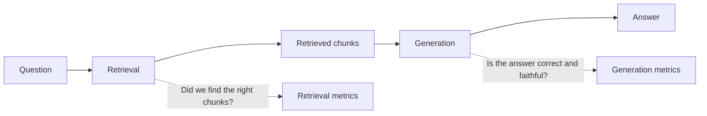
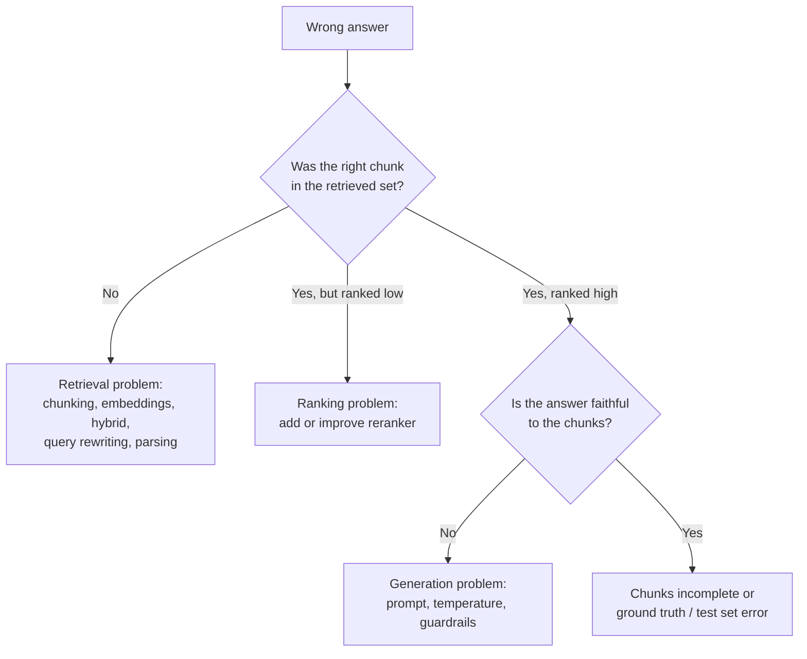

# 13 - Evaluation: How Do You Know Your RAG Actually Works?

> For a long time, my way of testing RAG was to ask five questions, read the answers, and think "looks good". That is not evaluation. It misses failures, and it can't tell me whether a change made things better or worse. Evaluation is what turns RAG from a demo into engineering. This chapter covers the few things that matter: build a test set, measure retrieval and generation **separately**, use LLM judges and RAGAS carefully, and run experiments one change at a time.

**What you'll understand after this chapter**

- Why you must evaluate retrieval and generation separately
- How to build a test set
- The key retrieval metrics and the key generation metrics
- How to use LLM-as-judge and RAGAS (and their limits)
- How to run fair experiments and find the cause of failures

---

## 1. Why Evaluate?

Without measurement:

- You can't tell if a change helped (a new chunk size, a reranker, a new prompt)
- A fix for one question may silently break five others
- You can't show anyone that your system is good

With measurement, every decision becomes: *change one thing, run the test set, compare numbers.* That is also what makes this guide a strong portfolio piece.

---

## 2. Evaluate in Two Parts

A RAG answer can go wrong in two different places, so we measure them separately.



| Part | Question it answers | If it's bad |
|---|---|---|
| **Retrieval** | Did the right chunks reach the prompt? | Fix chunking, embeddings, hybrid search, reranking, query transformation |
| **Generation** | Given the chunks, was the answer correct, faithful, and useful? | Fix the prompt, context assembly, model, guardrails |

> **The key debugging rule:** if the answer is wrong, first check retrieval. If the right chunk wasn't retrieved, the generation couldn't have succeeded. If it was retrieved and the answer is still wrong, it's a generation problem.

---

## 3. Building a Test Set

Everything depends on a good test set. It is the most valuable asset in your project.

### 3.1 What goes in it

Each item has:

```json
{
  "id": "q1",
  "question": "What is the refund window for the Premium plan?",
  "ground_truth": "Premium plan purchases can be refunded within 14 days of payment.",
  "relevant_chunks": [{"source": "refund_policy.pdf", "page": 3}],
  "type": "factual"
}
```

- **question:** what a user would ask
- **ground_truth:** the correct answer, written by a human
- **relevant_chunks:** where the answer lives (source and page is easier to maintain than exact chunk IDs, which change when you re-chunk)
- **type:** the kind of question, so you can see results per type

### 3.2 What kinds of questions to include

| Type | Example | Why |
|---|---|---|
| **Factual lookup** | "What is the refund window?" | The basics |
| **Paraphrased / vague** | "Can I get my money back?" | Tests the wording gap |
| **Exact-term** | "What does error E-4021 mean?" | Tests keyword matching |
| **Multi-chunk** | "Compare leave and refund policy" | Tests multi-part retrieval |
| **Follow-up** | "And for Basic?" (with history) | Tests conversation handling |
| **Unanswerable** | A question the documents don't cover | Tests "I don't know" |
| **Tricky / adversarial** | Contradictions, instructions in documents | Tests guardrails |

Don't only write easy questions. The hard ones are where you learn something.

### 3.3 How many?

Start with **30 to 50 questions** and grow over time. Even 20 well-chosen questions are far better than none. The more your metrics matter, the larger the set should be, since small sets give noisy results.

### 3.4 How to create them

1. **Write by hand** from your own documents (best quality). Mix easy and hard.
2. **Use real user questions** from logs, once you have a running system.
3. **Generate with an LLM:** give it a chunk and ask for a question that the chunk answers, plus the answer. This is fast, but the generated questions are often too easy and too similar to the chunk's wording. **Always review them by hand**, and mix them with handwritten ones.

```python
def generate_test_item(chunk):
    prompt = f"""Based only on the passage, write one question a user might ask
and the correct answer. Make the question natural, not copying the passage's wording.
Return JSON: {{"question": "...", "ground_truth": "..."}}

Passage: {chunk['text']}"""
    return json.loads(llm(prompt))
```

### 3.4 Keep it honest

- Keep a **fixed test set** for comparing versions. Don't keep changing it.
- Don't tune your system on the same questions you report as final results. Keep a few **held-out questions** you never look at while tuning.
- Update the set when documents change.

---

## 4. Retrieval Metrics

These measure whether the right chunks were found. They don't need an LLM, so they are cheap and repeatable.

| Metric | What it tells you | Simple meaning |
|---|---|---|
| **Hit rate / Recall@k** | Was a correct chunk in the top k? | "Did we find it at all?" |
| **MRR** (Mean Reciprocal Rank) | How high was the first correct chunk? | 1st place = 1, 2nd = 0.5, 3rd = 0.33 |
| **Precision@k** | What fraction of the top k were relevant? | "How much junk did we send?" |
| **nDCG** | Ranking quality when some chunks are more relevant than others | Rewards putting the best first |

For RAG, **Recall@k and MRR are the most useful starting pair.** Recall@k tells you whether the answer was available, and MRR tells you whether it was ranked high.

```python
def evaluate_retrieval(test_set, search_fn, k=5):
    hits, rr_total, precision_total = 0, 0, 0
    for item in test_set:
        results = search_fn(item["question"], k)
        relevant = {(r["source"], r["page"]) for r in item["relevant_chunks"]}

        flags = [(r["metadata"]["source"], r["metadata"]["page"]) in relevant for r in results]

        if any(flags):
            hits += 1
            rr_total += 1 / (flags.index(True) + 1)
        precision_total += sum(flags) / k

    n = len(test_set)
    return {"recall@k": hits / n, "mrr": rr_total / n, "precision@k": precision_total / n}
```

Skip unanswerable questions in this calculation, since they have no relevant chunk.

---

## 5. Generation Metrics

These measure the quality of the final answer. There is no single number, so we look at a few separate qualities.

| Metric | Question it answers | Needs |
|---|---|---|
| **Faithfulness (groundedness)** | Is every claim in the answer supported by the retrieved chunks? | Answer + chunks |
| **Answer relevance** | Does the answer actually address the question? | Question + answer |
| **Answer correctness** | Does the answer match the ground truth? | Answer + ground truth |
| **Context precision** | Are the retrieved chunks relevant, and are the best ones ranked first? | Question + chunks |
| **Context recall** | Do the chunks contain everything needed for the ground truth answer? | Chunks + ground truth |

### Reading them together

| Faithfulness | Correctness | What it means |
|---|---|---|
| High | High | Working well |
| High | Low | The answer follows the chunks faithfully, but the chunks were wrong or incomplete (a **retrieval** problem) |
| Low | Low or high | The model is adding things not in the context (a **generation / hallucination** problem). A high correctness here may be luck from the model's own knowledge |

An answer can be correct but unfaithful (the model knew it from training, not from your documents). That is risky, because you can't trust it next time.

### Other things to track

- **Abstention accuracy:** for unanswerable questions, does the bot say "I couldn't find this" instead of guessing?
- **Citation accuracy:** do cited sources really support the claims?
- **Latency and cost** per question (a better answer that takes 10 times longer may not be better overall)

---

## 6. LLM-as-Judge

Judging answers by hand for every experiment is slow. A common solution is to ask an LLM to grade them.

```python
def judge_correctness(question, answer, ground_truth):
    prompt = f"""You are grading an answer to a question.

Question: {question}
Reference answer: {ground_truth}
Answer to grade: {answer}

Does the answer give the same key information as the reference answer, with no
contradictions? Reply with JSON: {{"score": 0 or 1, "reason": "one sentence"}}"""
    return json.loads(llm(prompt))

def judge_faithfulness(answer, context):
    prompt = f"""Check whether each claim in the answer is supported by the context.

Context: {context}
Answer: {answer}

Reply with JSON: {{"supported_claims": n, "total_claims": n, "reason": "one sentence"}}"""
    return json.loads(llm(prompt))
```

### Limits of LLM judges (important)

- **They make mistakes**, and can be inconsistent between runs.
- **Bias:** they may prefer longer answers, or answers that sound confident, or answers written by the same model family.
- **Use a strong model as judge**, set the temperature to 0, and use a clear scoring rubric.
- **Calibrate:** manually grade 20 to 30 answers, and check how often the judge agrees with you. If agreement is low, improve the judge prompt.
- Prefer **simple scores** (pass/fail or 1 to 5 with clear definitions) over vague ones.
- Use the judge to **compare versions** on the same questions. Treat the absolute number with caution.

---

## 7. RAGAS

**RAGAS** is a popular open-source library that implements these metrics using LLM judges. Its main metrics:

| RAGAS metric | Measures |
|---|---|
| **faithfulness** | Answer claims supported by the retrieved context |
| **answer_relevancy** | How well the answer addresses the question |
| **context_precision** | Relevant chunks ranked high |
| **context_recall** | Retrieved context covers the ground truth |

A typical use looks like this:

```python
from datasets import Dataset
from ragas import evaluate
from ragas.metrics import faithfulness, answer_relevancy, context_precision, context_recall

data = {
    "question":     [...],
    "answer":       [...],      # what your RAG system answered
    "contexts":     [...],      # list of retrieved chunk texts for each question
    "ground_truth": [...],      # your reference answers
}

result = evaluate(Dataset.from_dict(data),
                  metrics=[faithfulness, answer_relevancy, context_precision, context_recall])
print(result)
```

**Important:** RAGAS changes its API and column names between versions (newer versions use names like `user_input`, `response`, `retrieved_contexts`, and `reference`). Check the documentation for the version you install, and don't copy the code above blindly.

Tips:

- RAGAS makes **many LLM calls**, so it costs money and time. Run it on the test set, not on every live query.
- Its scores come from LLM judges, so the limits from section 6 apply.
- Other tools do similar work (TruLens, DeepEval, and others). The ideas are the same, so learn the metrics first and the tool second.

---

## 8. Running Experiments the Right Way

The goal is to learn what each change does.

1. **Fix the test set** and settings.
2. **Change one thing at a time** (for example, chunk size only).
3. **Run the full test set** and record retrieval metrics, generation metrics, latency, and cost.
4. **Look at the failures**, not just the average. Read 5 to 10 wrong answers and find the pattern.
5. **Repeat** with the next change.

```python
def run_experiment(name, pipeline, test_set):
    rows = []
    for item in test_set:
        out = pipeline(item["question"])      # returns {"answer": ..., "chunks": [...], "latency": ...}
        rows.append({"item": item, "out": out})

    retrieval = evaluate_retrieval_from_rows(rows)
    generation = evaluate_generation_from_rows(rows)     # judges / RAGAS
    return {"name": name, **retrieval, **generation}
```

A results table is the core portfolio artifact:

| Experiment | Recall@5 | MRR | Faithfulness | Correctness | Avg. latency |
|---|---|---|---|---|---|
| Baseline (dense, 500 tokens) | | | | | |
| + Hybrid search | | | | | |
| + Reranker | | | | | |
| + Query rewriting | | | | | |
| Chunk size 250 vs 500 vs 1000 | | | | | |

### Avoid fooling yourself

- **Small test sets are noisy.** A 2-point change on 20 questions means nothing. Look for clear differences.
- **LLM outputs vary.** Use temperature 0 for evaluation runs, and repeat important comparisons.
- **Don't overfit** to your test questions. Keep some held-out ones.
- **Look at per-type results.** An improvement on factual questions can hide a drop on follow-ups.

---

## 9. Finding the Cause of a Failure

When a test question fails, follow this order:



Also remember that **the test set itself can be wrong.** If many "failures" look correct to you, check the ground truth.

---

## 10. Evaluation After Launch

Offline tests are not the whole story. Once real users arrive:

- **Log** questions, retrieved chunks, answers, latency, and cost (watch privacy).
- Collect **user feedback** (thumbs up and down, "was this helpful?").
- **Review failures** regularly and add them to the test set.
- Run the test set **automatically** when you change the pipeline, to catch regressions.
- Watch for **drift**: documents change and user questions change over time.

---

## 11. Common Mistakes

- **Only trying a few questions by hand** and calling it tested.
- **Measuring only the final answer**, so you can't tell if retrieval or generation failed.
- **Test sets of only easy, LLM-generated questions.**
- **Changing several things at once**, so you don't know what helped.
- **Trusting LLM judge scores blindly**, without checking them against human judgment.
- **Tuning on the test set** and then reporting those numbers as final.
- **Ignoring unanswerable questions**, so you never measure hallucination.
- **Ignoring latency and cost**, which are part of quality.
- **Copying RAGAS code from old tutorials** without checking the installed version.

---

## 12. Key Takeaways

1. **Evaluate retrieval and generation separately.** It tells you where the problem is.
2. A **good test set** (30 to 50 mixed questions, including unanswerable and tricky ones, with human-checked ground truth) is your most valuable asset.
3. Retrieval: start with **Recall@k and MRR**. Generation: look at **faithfulness, answer relevance, and correctness**, and read them together.
4. **LLM judges and RAGAS** save time but make mistakes. Calibrate them against your own judgment.
5. Change **one thing at a time**, keep a **fixed test set**, and track **latency and cost** along with quality.
6. Debug in order: **was the right chunk retrieved, was it ranked well, was the answer faithful?**
7. Keep evaluating after launch with logs, feedback, and automatic regression tests.

---

## 13. Quick Self-Check

1. Why do we evaluate retrieval and generation separately?
2. What do Recall@k and MRR each tell you?
3. An answer is faithful but incorrect. What does that suggest?
4. Name two weaknesses of LLM-as-judge and how to reduce them.
5. Why should a test set contain unanswerable questions?
