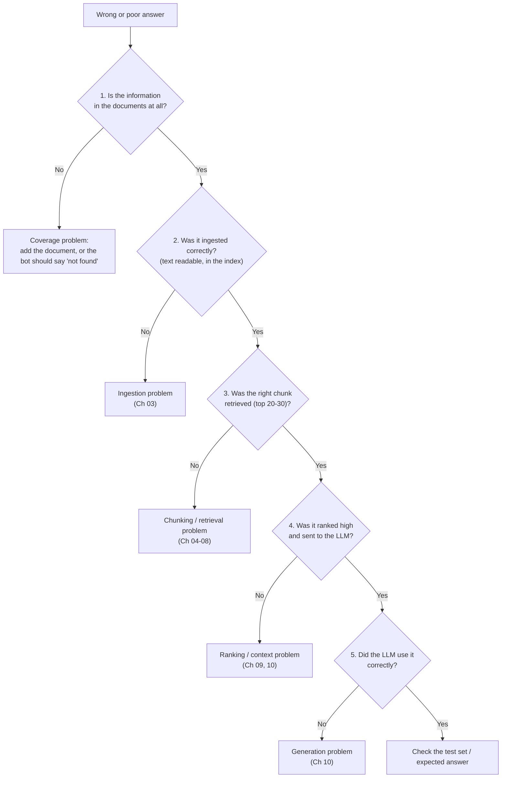

# 15 - Failure Modes: A Debugging Playbook for RAG

> Every RAG system fails sometimes. The difference between a beginner and an experienced builder is not that the experienced one avoids failures, but that they know **where to look**. When my chatbot gave a wrong answer, I used to change the prompt first, because it was the easiest thing to edit. Most of the time the real problem was earlier in the pipeline. This chapter is the playbook I wish I had: a simple debugging order, the most common failures at each stage, and how to fix them.

**What you'll understand after this chapter**

- A step-by-step way to debug any wrong answer
- The most common failures at every stage, with symptoms and fixes
- A small debug tool to see what your pipeline is really doing
- In what order to try fixes, from cheapest to most complex

---

## 1. The Golden Rule: Find the Stage First

A RAG answer goes through many stages. A bad answer means **one of them failed**. Don't guess. Check the stages in order, from the beginning.



The five questions, in short:

1. **Is the answer in the documents?**
2. **Was it ingested properly?**
3. **Was it retrieved?**
4. **Was it ranked high and included in the prompt?**
5. **Did the LLM use it correctly?**

Most failures are found at question 2 or 3.

---

## 2. A Debug Tool: See What the Pipeline Sees

Before fixing anything, **look at the trace** of one failing question.

```python
def debug_query(question, history=None):
    print("QUESTION:", question)

    standalone = make_standalone(history, question) if history else question
    print("\nSEARCH QUERY:", standalone)

    candidates = hybrid_search(standalone, k=20)
    print(f"\nCANDIDATES ({len(candidates)}):")
    for i, c in enumerate(candidates[:10], 1):
        m = c["metadata"]
        print(f"  {i}. {m['source']} p.{m['page']} | {c['text'][:90]!r}")

    top = rerank(standalone, candidates, top_n=5)
    print("\nAFTER RERANK:")
    for i, c in enumerate(top, 1):
        m = c["metadata"]
        print(f"  {i}. score={c['rerank_score']:.2f} | {m['source']} p.{m['page']} | {c['text'][:90]!r}")

    prompt = build_user_prompt(standalone, top)
    print("\nPROMPT TOKENS:", len(enc.encode(SYSTEM_PROMPT + prompt)))

    answer = generate(standalone, top)
    print("\nANSWER:", answer)
```

This single function answers questions 3, 4, and 5 for any failing query. Add a way to search for a known phrase in the raw text to answer questions 1 and 2:

```python
def find_in_corpus(phrase):
    """Is the answer text anywhere in the ingested chunks?"""
    return [c for c in all_chunks if phrase.lower() in c["text"].lower()]
```

If `find_in_corpus("14 days")` returns nothing, the problem is in the **documents or ingestion**, not in retrieval.

---

## 3. Failures by Stage

For each failure: **what you see, why it happens, how to fix it.**

### 3.1 Ingestion failures ([Chapter 03](./03-data-ingestion.md))

| What you see | Likely cause | Fix |
|---|---|---|
| Bot says "not found" for content that is clearly in the PDF | Scanned pages gave empty text | Detect low-text pages, run OCR |
| Chunks are full of strange characters or broken words | Bad parsing, hyphenation, encoding | Try another parser, clean text |
| Table answers are wrong or mixed up | Table flattened into plain text | Extract tables, convert to Markdown, keep whole |
| Sentences from two columns are mixed | Multi-column layout read line by line | Layout-aware parser |
| Retrieval returns "Page 4 of 20 - Confidential" everywhere | Repeated headers and footers | Remove repeated lines |
| Old answers appear after a policy changed | Outdated document still indexed | Metadata versioning, delete old chunks |
| Same text retrieved several times | Duplicate documents | Deduplicate with file hashes |

**Quick check:** print 3 random chunks and read them.

### 3.2 Chunking failures ([Chapter 04](./04-chunking.md))

| What you see | Likely cause | Fix |
|---|---|---|
| The answer is cut in half across two chunks | Boundary in the wrong place, no overlap | Add overlap, structure-aware or recursive splitting, parent-child |
| Retrieval finds the right topic but the details are missing | Chunks too small | Larger chunks, or parent-child retrieval |
| Right chunk exists but ranks low, and is long and mixed | Chunks too large and unfocused | Smaller chunks |
| Chunk says "It costs 25 dollars" and no one knows what "it" is | Chunk lost its context | Add title or section to the chunk text |
| End of every chunk is ignored | Chunk longer than the embedding model's limit | Keep chunks under the model's max length |
| Table or list split in the middle | Splitting ignored structure | Keep tables and lists whole |

### 3.3 Embedding failures ([Chapter 05](./05-embeddings.md))

| What you see | Likely cause | Fix |
|---|---|---|
| Results look random | Different models for documents and queries | Use one model, re-embed |
| Results got worse with a "better" model | Missing query or passage prefix the model needs | Read the model card, add the prefix |
| Non-English questions fail | English-only model | Use a multilingual model |
| Domain terms are not understood | General model, specialized text | Try another model, test on your data, consider fine-tuning |
| Scores are all very similar | Vectors not normalized or wrong metric | Normalize, use the right metric |

### 3.4 Retrieval failures ([Chapters 06, 07, 08](./07-retrieval.md))

This is the largest group.

| What you see | Likely cause | Fix |
|---|---|---|
| Exact codes, names, or IDs are not found | Dense-only search | Add BM25 (hybrid search) |
| Right chunk is in the top 20 but not the top 5 | Rough first-stage ranking | Add a reranker |
| Short or vague questions fail | Weak query | Query rewriting, multi-query |
| Follow-up questions fail | No standalone rewrite | Conversational rewriting ([Ch 11](./11-conversational-rag.md)) |
| Question and document use different words | Wording gap | Hybrid search, multi-query, test HyDE |
| Question needs two separate passages | k too small, one search | Multi-query, decomposition, larger k |
| Good document exists, but never appears | Metadata filter too strict, or wrong metadata | Check filters, check stored metadata values |
| Same fact repeated in all results | Duplicates from overlap | MMR, deduplication, less overlap |
| Out-of-scope question still returns "results" | No score threshold | Threshold + "not found" answer |
| ANN index misses known results | Index settings too aggressive | Increase search effort (like `efSearch`), compare to Flat |

### 3.5 Reranking failures ([Chapter 09](./09-reranking.md))

| What you see | Likely cause | Fix |
|---|---|---|
| Reranking changes nothing | Right chunk not in the candidates (recall problem) | Fix stage 1, retrieve more candidates |
| Reranking makes results worse | Wrong model for the language or domain, or chunks cut off by input limit | Try another reranker, check max length |
| Too slow | Too many candidates, large model | Fewer candidates, lighter model, GPU |

### 3.6 Context and prompt failures ([Chapter 10](./10-generation.md))

| What you see | Likely cause | Fix |
|---|---|---|
| Right chunk was retrieved, but the answer ignores it | Too many chunks, answer buried in the middle | Fewer chunks, best first |
| Answer is cut off or the prompt errors out | Token budget exceeded | Count tokens, limit chunks, leave space for the answer |
| Answer mixes two conflicting versions | Old and new documents both retrieved | Metadata dates, filter, tell the model how to handle conflicts |
| Bot answers from general knowledge, not documents | Weak "use only the context" rule | Stricter system prompt, lower temperature |
| Bot invents an answer when nothing was found | No "I don't know" instruction | Add the rule, add a score threshold |
| Bot refuses to answer even though the chunk is there | Prompt too strict, or chunk phrased differently | Relax the rule slightly, allow partial answers, check the retrieved text |

### 3.7 Generation failures ([Chapter 10](./10-generation.md))

| What you see | Likely cause | Fix |
|---|---|---|
| Wrong numbers, names, or dates | Hallucination or misreading | Lower temperature, "do not guess" rule, quote exact values, verify with a faithfulness check |
| Citation points to the wrong page | Model attached wrong source number | Check citations after generation, show quotes |
| Answer is long and rambling | No length instruction | "Be concise", max tokens |
| Answer in the wrong language | No language rule | "Answer in the user's language" |
| Follows a hidden instruction from a document | Prompt injection | Context-is-data rule, delimiters, limit model powers |
| Different answer each time | High temperature | Lower the temperature |

### 3.8 Conversation failures ([Chapter 11](./11-conversational-rag.md))

| What you see | Likely cause | Fix |
|---|---|---|
| "And what about Basic?" returns nonsense | Follow-up sent raw to the retriever | Standalone rewrite |
| Bot keeps talking about the old topic | Rewriter pulls in old context after a topic change | Better rewrite prompt, test topic switches |
| Answers get worse in long chats | History too long, summary lost details | Summary + last few turns, trim history |
| Bot answers from memory when it should search | Search classifier too eager to skip | Default to searching |

### 3.9 System failures ([Chapter 14](./14-production.md))

| What you see | Likely cause | Fix |
|---|---|---|
| Answers are outdated | Stale index or cache | Incremental updates, clear caches on update |
| Very slow | Too many LLM calls, many chunks | Measure per step, trim steps, stream |
| Surprise bill | Many tokens per query | Fewer chunks, smaller model, caching, limits |
| A user sees another team's data | Missing permission filter, shared cache | Filter inside retrieval, permissions in cache keys |
| Different results after a deployment | Embedding model or chunking changed without re-indexing | Version the index, re-embed after changes |

---

## 4. The Symptom Quick Finder

| Symptom | Check first |
|---|---|
| "I couldn't find this" but it's in the documents | `find_in_corpus` (ingested?), then retrieval candidates |
| Confident but wrong answer | Were the right chunks retrieved? If yes, a generation problem |
| Right chunk found but answer still wrong | Prompt size and order, temperature, conflicting chunks |
| Correct sometimes, wrong other times | Temperature, retrieval variance, borderline rankings |
| Good on simple questions, bad on complex ones | Query transformation, k, decomposition |
| Good in testing, bad with real users | Test set doesn't match real questions, so add real questions |
| Got worse after a change | Compare against your saved baseline from [Chapter 13](./13-evaluation.md) |

---

## 5. In What Order Should You Fix Things?

Start with the **cheapest, most likely** causes. This order has worked well for me:

1. **Data and ingestion.** Is the text clean, complete, and current? (Cheap and most common.)
2. **Chunking.** Are the chunks sensible and the right size?
3. **Retrieval basics.** Hybrid search, a good k, metadata filters, a score threshold.
4. **Reranking.** If the right chunk is in the candidates but ranked low.
5. **Prompt and context.** Rules, fewer chunks, ordering, "I don't know".
6. **Query transformation.** For vague, follow-up, or multi-part questions.
7. **Model changes.** Embedding model, reranker, or LLM.
8. **Advanced techniques** (Graph RAG, agents, and so on), only when a specific failure justifies them.

After every fix: **re-run the test set** and compare with the baseline, so you know the fix helped and didn't break something else.

---

## 6. Three Short Case Studies

**Case 1: "Bot says it can't find the leave policy."**
`find_in_corpus("paid leave")` returns nothing. Checking the PDF, the policy is on scanned pages that produced empty text. **Fix:** detect low-text pages and run OCR. *The prompt was never the problem.*

**Case 2: "Bot gives the wrong refund period."**
`debug_query` shows two chunks: an old policy (7 days) ranked first and the new one (14 days) ranked second. The model used the first. **Fix:** store a version date in metadata, remove outdated documents from the index, and tell the model to prefer the newest source if there is a conflict. *The LLM did exactly what the chunks told it.*

**Case 3: "Error E-4021 returns general troubleshooting advice."**
Candidates contain generic error-handling chunks, but not the one with "E-4021". **Fix:** add BM25 hybrid search. Recall@5 for exact-code questions goes up in the test set. *A retrieval-method problem, not a prompt problem.*

The pattern repeats: **look at the trace, find the stage, fix the cause.**

---

## 7. Preventing Failures

- **Keep a growing test set.** Every bug you fix becomes a new test question, so it can't return unnoticed.
- **Run the test set after every change** (even a small prompt edit).
- **Log failures in production** and review thumbs-down answers and "not found" cases weekly.
- **Version your pipeline:** index version, embedding model, chunk settings, prompt version. Then you can say exactly what changed.
- **Change one thing at a time.**
- **Make debugging easy:** keep a `debug_query`-style tool and use it.

---

## 8. Key Takeaways

1. **Don't edit the prompt first.** Find the failing stage, because most failures happen before the LLM.
2. Ask five questions in order: **in the documents? ingested? retrieved? ranked and included? used correctly?**
3. A simple **trace tool** and a **search-the-corpus tool** answer most of these questions in minutes.
4. The most common failures: **bad parsing, bad chunks, retrieval misses (exact terms, vague queries, follow-ups), outdated documents, and a prompt with no "I don't know" rule.**
5. Fix in order from **cheap to complex**: data, chunking, retrieval, reranking, prompt, query transformation, models, advanced techniques.
6. **Turn every fixed bug into a test question**, and re-run the test set after every change.

---

## 9. Quick Self-Check

1. What are the five questions to ask when an answer is wrong?
2. How do you tell if a problem is in ingestion or in retrieval?
3. The right chunk was retrieved and ranked first, but the answer is wrong. Where do you look next?
4. Why is "change the prompt" often the wrong first fix?
5. How can a fixed bug come back, and how do you prevent it?

